# MTTN AutoSubs Tool

> 🌐 [Español](README.md) | **English**

[](https://github.com/la-matatena/mttn-autosubs-tool/actions/workflows/ci-release.yml)
[](https://github.com/la-matatena/mttn-autosubs-tool/releases/latest)
[](LICENSE)
[](pyproject.toml)
[](docs/user-guide.md)
[](install_imac.sh)
[](https://github.com/la-matatena)

**MTTN AutoSubs Tool** (by **[La Matatena](https://la-matatena.com)** · [@la-matatena](https://github.com/la-matatena)) helps Spanish-language creators generate accurate subtitles locally on macOS—either as a standalone desktop and CLI studio or paired directly with DaVinci Resolve 20 Free and Studio—without sending audio to cloud servers or exhausting GPU VRAM. It ships tuned for a 2017 Retina 4K iMac (`3 GHz Quad-Core Intel Core i5`, `32 GB DDR4 RAM`, `2 GB AMD Radeon Polaris VRAM`) and Apple Silicon, runs persistent-prompt 8-bit and full Large-v3 Whisper models, and recognizes Spanish board-game terms and anglicisms out of the box.

The user interface follows clean macOS standards in both dark and light modes with neutral surfaces and high-contrast typography, reserving La Matatena's signature purple (`#8367c7`) strictly for active highlights, focus rings, and primary actions. It features an integrated **light and dark theme toggle** in the top bar that automatically respects and syncs with your macOS system preference.

> **La Matatena Open Projects Convention:** All open tools under [`github.com/la-matatena`](https://github.com/la-matatena) follow the [**MTTN Standards**](https://github.com/la-matatena/.github/blob/main/CONVENTIONS.md) naming convention (**`MTTN` + `TwoWordNameInPascalCase` + `[Suffix]`**, e.g., **MTTN AutoSubs Tool**, **MTTN PaperCraft Studio**) and La Matatena's `#8367c7` / `#6a4fb3` brand palette.

## Interface preview

MTTN AutoSubs Tool adapts the workflow seamlessly between DaVinci Resolve 20 timeline insertion and Standalone local video subtitling, featuring an intuitive numbered 6-step flow:

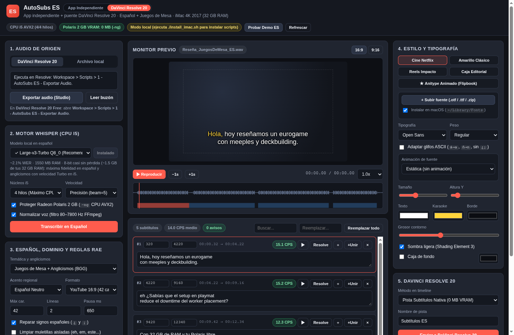

*Three-column studio in **DaVinci Resolve 20** mode with `Large-v3-Turbo Q8_0` selected, **Juegos de Mesa + Anglicismos (BGG)** active, and live Spanish karaoke rendering in **Monitor previo**.*

The mode switcher sits next to the title in the top bar:


Each section below shows a close-up of the part of the interface it describes.

## Documentation

Read the detailed guides for workflows, hardware tuning, Spanish RAE rules, and troubleshooting:

| Guide | Audience | Coverage |
| :--- | :--- | :--- |
| [User guide](docs/user-guide.md) | Video editors and creators | macOS app installation, standalone CLI and MP4 export, Resolve Free and Studio audio export, styling, and timeline insertion. |
| [Engineering design document](docs/design-doc.md) | Engineers and maintainers | System design, hardware constraints, rejected alternatives, subsystem specifications, localhost CSRF guards, and verification strategy. |
| [Architecture and 2017 iMac tuning](docs/imac-2017-architecture.md) | Developers and technical editors | System diagram, CPU and VRAM governor, 32 GB GGML model catalog, `--carry-initial-prompt`, Resolve Lua IPC, and HTTP API endpoints. |
| [Spanish subtitling reference](docs/spanish-subtitling-reference.md) | Editors and localization teams | Board-game domain and anglicism repairs, dialect prompts, BPE and UTF-8 repair, inverted punctuation repair, and RAE weak-ending wrapping. |
| [Troubleshooting guide](docs/troubleshooting.md) | Video editors | Gatekeeper permissions, Homebrew binary detection, manual SRT import, Media Pool `Text+` setup, and 2 GB VRAM tips. |

## Hardware optimization for the 2017 Retina 4K iMac and Apple Silicon

Every processing step is tuned for a 2017 iMac (Retina 4K, 21.5-inch) with a 3 GHz Quad-Core Intel Core i5 (`x86_64` AVX2), AMD Radeon Polaris 2 GB VRAM, 32 GB 2400 MHz DDR4 RAM, and macOS 15+, while also running at high efficiency on Apple Silicon (`arm64`):

| Component | Configuration | Benefit |
| :--- | :--- | :--- |
| Inference engine | Native `whisper-cpp` (`whisper-cli`) | Runs compiled `x86_64` AVX2 or `arm64` binaries natively without missing Python wheels. |
| GPU protection | Enforces the `--no-gpu` (`-ng`) flag on Polaris | Keeps 0 MB load on the 2 GB Radeon Polaris GPU so macOS WindowServer and DaVinci Resolve 20 avoid VRAM errors during 4K playback. |
| Memory allocation | `ggml-large-v3-turbo-q8_0.bin` default (`1.55 GB` RAM) | Takes advantage of your RAM for near-lossless 8-bit quantization without sacrificing Turbo speed. |
| Prompt persistence | Auto-detects `--carry-initial-prompt` with `-mc 64` | Preserves Spanish punctuation and board-game vocabulary conditioning across every 30-second window of long videos. |
| CPU thread governor | `3` threads with `nice -n 10` when Resolve runs (`4` standalone) | Uses full Core i5 throughput in standalone mode while reserving 1 core whenever DaVinci Resolve 20 is open. |
| Timeline rendering | Native SRT, CPU `libx264` MP4 burn-in, or GPU-light `Text+` | Burns standalone MP4 files on CPU with 0 MB VRAM, or renders native 3840x2160 vector Resolve titles safely. |

### Automatically detected hardware profiles

On startup the app detects the machine and picks a profile (shown in step **2. Motor Whisper** and in the top-bar badges):

| Profile | GPU for Whisper | Threads (standalone / with Resolve) | MP4 encoder |
| :--- | :--- | :--- | :--- |
| **Intel Mac** (such as the 2017 iMac) | Disabled (`-ng`) to protect low-VRAM GPUs | Based on the real core count (2017 iMac: 4 / 3) | `libx264` (CPU) |
| **Apple Silicon** (M1–M4 and later) | **Metal enabled** | Performance cores, max 8 / keeps cores free for Resolve | `h264_videotoolbox` (hardware media engine) |

Force a profile with `AUTOSUBS_HW_PROFILE=intel_imac2017` or `AUTOSUBS_HW_PROFILE=apple_silicon` (handy to simulate the 2017 iMac on another Mac).

### Per-machine performance (⚙ Esta Mac)

The status button in the top bar (⚙ with the CPU, GPU, and Resolve status) opens a panel with the detected hardware and the performance settings. They are saved **only on that Mac** (`~/Library/Application Support/AutoSubsES/settings.json`), so the iMac can stay in a safe profile while a MacBook runs at full speed:

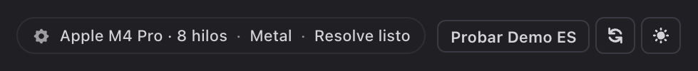

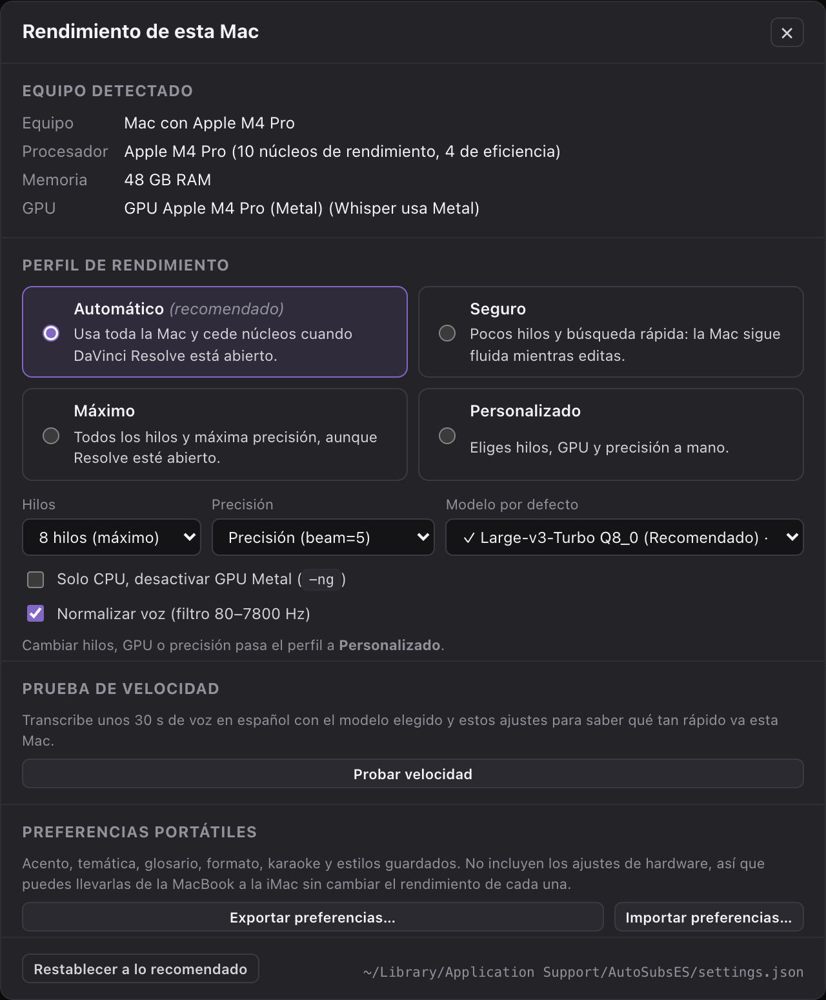

- **Profile**: **Automático** (recommended: uses the whole Mac and frees cores while Resolve is open), **Seguro** (few threads and fast beam search so editing stays smooth), **Máximo**, or **Personalizado** (threads, GPU, and precision by hand). Step 2 shows a one-line summary of the active profile (for example, `8 hilos · GPU · precisión`) and an **Ajustar…** link that opens this panel.
- Per-machine **default model** and **Restablecer a lo recomendado** (reset).
- **Probar velocidad** (speed test): transcribes ~30 s of Spanish system-voice speech with the chosen model and reports how many times faster than real time it runs, plus a model recommendation. Reference: on a MacBook Pro M4 Pro, `turbo-q8` runs 6–20× faster than real time with Metal (depending on whether the model is already in memory) and about 4× CPU-only.
- **Export / Import preferences**: dialect, domain, glossary, format, karaoke, and saved styles in a `.json` file to move them to another Mac **without** copying hardware settings.

Dialect, domain, glossary, and format are also remembered between sessions.

## Spanish Whisper models for 32 GB RAM

Your RAM removes bottlenecks for larger quantized GGML models. Download models inside **2. Motor Whisper** with automatic HTTP resume support:

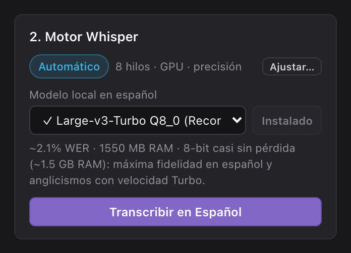

| Model ID | Filename | Download size | Peak RAM | Approximate Spanish WER | Recommended role |
| :--- | :--- | :--- | :--- | :--- | :--- |
| `turbo-q8` | `ggml-large-v3-turbo-q8_0.bin` | 834 MB | 1,550 MB | 2.1% | Default recommended choice: 8-bit near-lossless Spanish and anglicism accuracy with 4-layer Turbo speed. |
| `large-v3-q5` | `ggml-large-v3-q5_0.bin` | 1,080 MB | 2,100 MB | 1.9% | Maximum Spanish and bilingual board-game accuracy with a full 32-layer decoder when speed is secondary. |
| `turbo-q5` | `ggml-large-v3-turbo-q5_0.bin` | 547 MB | 1,100 MB | 2.3% | Balanced 5-bit Turbo alternative for long episodes that prioritize faster turnaround. |
| `small-q8` | `ggml-small-q8_0.bin` | 252 MB | 650 MB | 5.2% | Fast rough cuts and quick dialogue drafts on 3 or 4 CPU threads. |
| `base-q8` | `ggml-base-q8_0.bin` | 82 MB | 320 MB | 8.2% | Lightweight pipeline validation when bandwidth is constrained. |

## Board-game vocabulary and anglicisms (`juegos_mesa`)

Spanish board-game channels mix regional Spanish grammar with English mechanics, publisher names, and Hispanicized pronunciations. MTTN AutoSubs Tool pairs **Temática y anglicismos** (`Juegos de Mesa + Anglicismos (BGG)` by default) with any regional **Acento regional** (`Español Neutro`, `España (Peninsular)`, `México / LatAm`, or `Río de la Plata`):

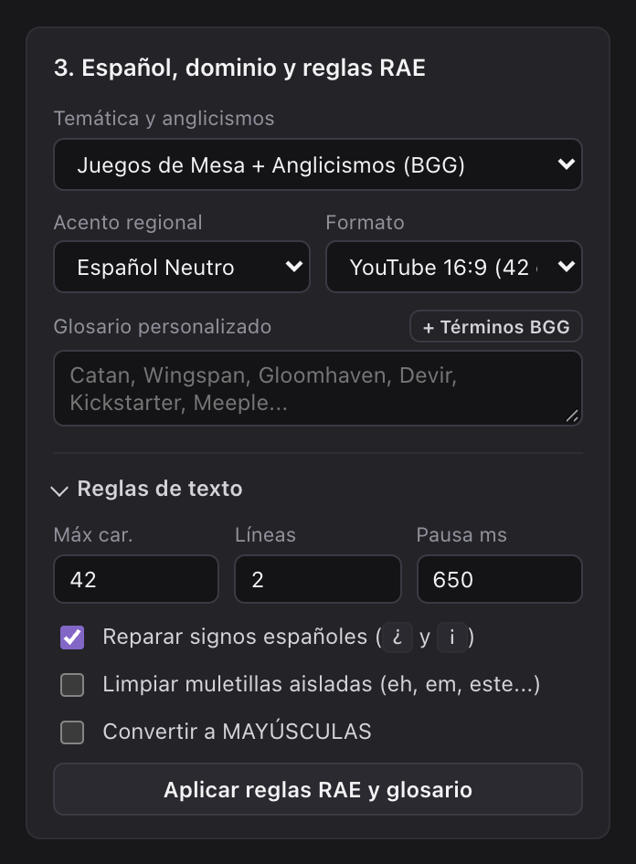

- **Persistent Whisper conditioning**: `build_spanish_initial_prompt` seeds `whisper-cli --prompt` with domain terms (`BoardGameGeek`, `BGG`, `eurogame`, `ameritrash`, `meeples`, `deckbuilding`, `worker placement`, `set collection`, `draft`, `setup`, `playmat`, `downtime`, `kingmaking`, `alpha player`, `filler`, `gateway`, `Kickstarter`, `Gamefound`) plus your **Glosario personalizado** and keeps them active across the whole timeline when `whisper-cli` supports `--carry-initial-prompt`.
- **Deterministic phonetic repair**: `BOARDGAME_PHONETIC_FIXES` corrects ~70 common Spanish Whisper phonetic mistakes after transcription—for example turning `eurogueim` into `eurogame`, `mipels` into `meeples`, `dec bilding` into `deckbuilding`, `setap` into `setup`, `pleimat` into `playmat`, `dauntaim` into `downtime`, `worker pleisment` into `worker placement`, `kikstarter` into `Kickstarter`, and `be ge ge` into `BGG`—while preserving case-insensitive custom glossary overrides from **+ Términos BGG**.
- **Hesitation-aware punctuation**: `_repair_inverted_spanish_punctuation` skips leading hesitations (`eh`, `em`, `mm`) before inserting `¿` or `¡`, turning `eh Sabías... ?` into `eh ¿Sabías...?` before optional filler cleanup runs.

## Install MTTN AutoSubs Tool on macOS

The installer sets up the `whisper-cpp`, `ffmpeg`, and `ffmpeg-full` packages through Homebrew (`ffmpeg-full` ships `libass`, required for MP4 burn-in), creates the standalone `~/Applications/MTTN AutoSubs Tool.app` macOS application bundle, copies the DaVinci Resolve 20 Lua bridge scripts and Fusion templates, and downloads the default `ggml-large-v3-turbo-q8_0.bin` Spanish model.

1. Open **Terminal** and clone or change to the `mttn-autosubs-tool` directory:

   ```bash
   git clone https://github.com/la-matatena/mttn-autosubs-tool.git
   cd mttn-autosubs-tool
   ```

2. Run the installer script:

   ```bash
   ./install_imac.sh
   ```

   Optional: Pass `--model=large-v3-q5` to download the full 32-layer maximum-accuracy Spanish model instead, or pass `--skip-model` to download models later inside the UI.

3. Launch **MTTN AutoSubs Tool** from **Applications** (`MTTN AutoSubs Tool.app`), double-click `Iniciar AutoSubs ES.command`, or run the server from Terminal:

   ```bash
   python3 -B autosubs_server.py --app-window
   ```

   The app opens in **its own macOS window** (Dock icon and a native "Save as…" dialog for exports); closing the window stops the local server. The installer sets this up with `pywebview` in an isolated environment (`~/Library/Application Support/AutoSubsES/venv`); without it, the app opens in Chrome, Brave, or Safari. Use `python3 -B autosubs_server.py --desktop` to start the native window from Terminal.

## Run as a standalone macOS application or CLI

You do not need DaVinci Resolve open or installed to subtitle videos, interviews, or board-game reviews:

1. Switch the top bar to **App Independiente** (the studio also selects this mode automatically on standalone app launches or when DaVinci Resolve is not running).
2. Drag any local audio or video file (`.wav`, `.mp3`, `.m4a`, `.mp4`, `.mov`, or `.mkv`) onto the upload zone in **1. Audio de origen**. Video uploads stream directly inside **Monitor previo** with frame-accurate Spanish subtitles and audio scrubbing.

   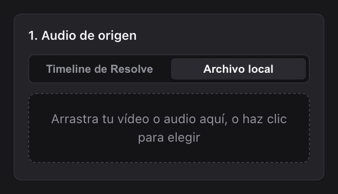
3. Configure **2. Motor Whisper** (`Large-v3-Turbo Q8_0` or `Large-v3 Completo Q5_0`) and **3. Español, dominio y reglas RAE**, then click **Transcribir en Español**.
4. Export from **6. Exportar**. **.SRT Estándar** and **Render MP4** are always visible; the other formats and **Copiar guion** are under **Más formatos**:

   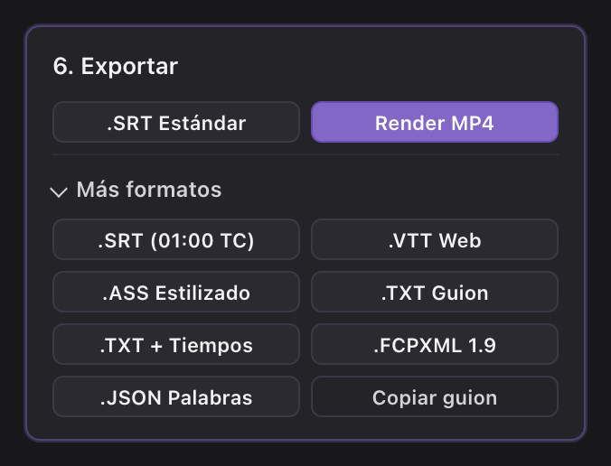

   - **Subtitle files**: Download `.SRT Estándar`, `.SRT (01:00 TC)`, `.VTT Web`, `.ASS Estilizado`, `.FCPXML 1.9`, or `.JSON Palabras`.
   - **Clean scripts and copy**: Export `.TXT Guion` (plain prose paragraphs), `.TXT + Tiempos` (timestamped review transcript), or copy the script to your clipboard with **Copiar guion**.
   - **Burned-in MP4 video**: Click **Render MP4** to encode an H.264 `.mp4` video: `libx264` on CPU (zero VRAM pressure) on Intel Macs, or hardware `h264_videotoolbox` on Apple Silicon. Requires `ffmpeg-full` (`brew install ffmpeg-full`).
   - **Word-by-word karaoke**: **off by default**. Enable it in **4. Estilo y tipografía** to highlight each word in the preview, the `.ASS` export, and the MP4. When you edit text, unchanged words keep their Whisper timings and new words share the remaining time.

### Headless CLI transcription

Transcribe local media files directly from Terminal into `.srt`, `.vtt`, `.ass`, `.txt`, and `.json` files without launching the browser UI:

```bash
python3 -B autosubs_server.py \
  --cli INPUT_MEDIA \
  --model turbo-q8 \
  --dialect neutro \
  --domain juegos_mesa \
  --output-srt OUTPUT_SRT
```

Replace the following:

- `INPUT_MEDIA`: the local audio or video file path to transcribe.
- `OUTPUT_SRT`: the destination path for the formatted Spanish `.srt` subtitle file.

## Use MTTN AutoSubs Tool with DaVinci Resolve 20

Switch the top bar to **DaVinci Resolve 20** whenever you want round-trip timeline integration with DaVinci Resolve 20 Free or DaVinci Resolve 20 Studio. See the [user guide](docs/user-guide.md) for detailed instructions.

### Export timeline audio

1. Open your project and target timeline in DaVinci Resolve 20.
2. In the top menu bar, click **Workspace** > **Scripts** > **1 - MTTN AutoSubs - Exportar Audio** (or click **Exportar audio (Studio)** directly in Resolve Studio).
3. Wait until the DaVinci Resolve Console reports that the audio bounce is complete, then return to MTTN AutoSubs Tool and click **Leer buzón**.

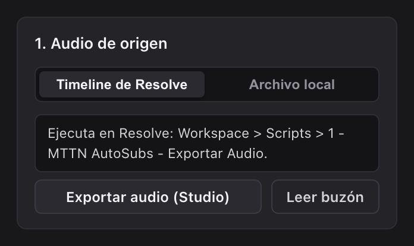

### Transcribe and edit Spanish subtitles

1. In **3. Español, dominio y reglas RAE**, select **Juegos de Mesa + Anglicismos (BGG)** (or **General / Documental** / **Tech y Edición Vídeo**) alongside your regional Spanish **Acento regional** (`Español Neutro`, `España`, `México / LatAm`, or `Río de la Plata`).
2. Add specific game titles, publisher names, or custom terms in **Glosario personalizado**, or click **+ Términos BGG** to prefill starter board-game vocabulary.
3. Click **Transcribir en Español**, then inspect cues in **Monitor previo** and the center editor (`÷`, `+Unir`, `×`, CPS badges, and **Aplicar reglas RAE y glosario**).

   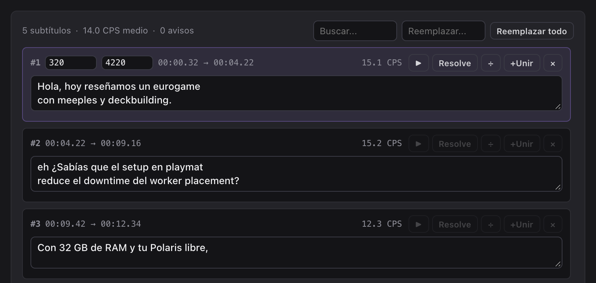

4. Adjust timings directly on the **waveform**: drag a purple block to move it, or its edges to change start and end (`Esc` cancels). Zoom with `+`/`−`, ⌘ + scroll, or trackpad pinch, and scroll to pan while zoomed.

   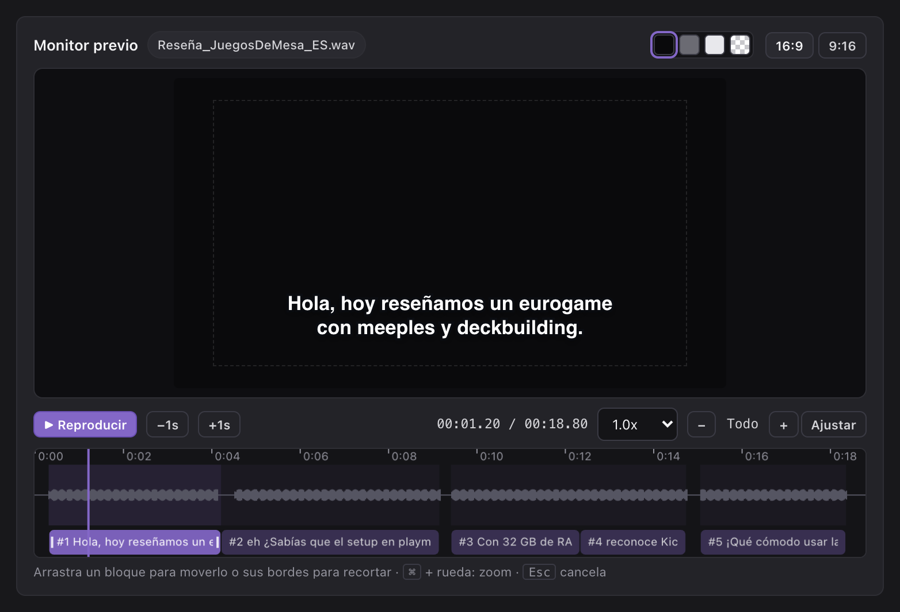

### Use custom fonts and animated packs

Upload `.otf`, `.ttf`, `.ttc`, or `.zip` font archives in **4. Estilo y tipografía** to preview them in **Monitor previo** and install them into `~/Library/Fonts` for DaVinci Resolve 20:

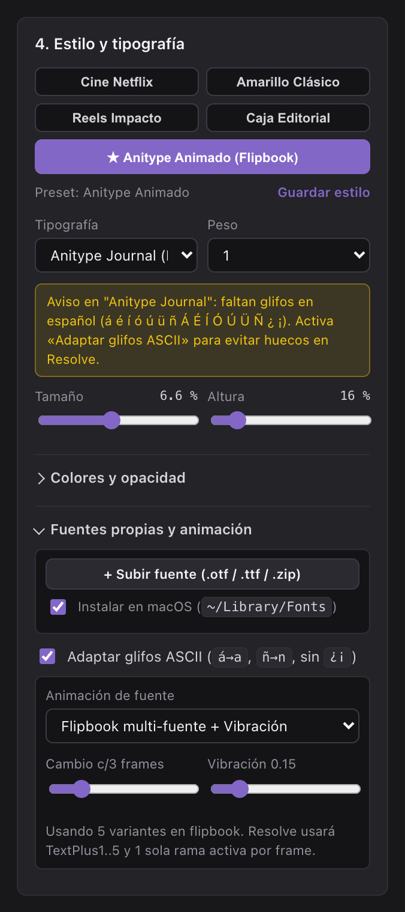

- Numbered variant packs (such as the five-font `Anitype Journal` flipbook archive) group automatically into a single **Packs animados (Flipbook)** entry.
- Fonts lacking Spanish glyphs (`á`, `é`, `í`, `ó`, `ú`, `ü`, `ñ`, `¿`, `¡`) trigger a glyph banner with an **Adaptar glifos ASCII** toggle so `Text+` renders complete words instead of blank spaces. **Monitor previo** shows the result (for example, «reseñamos» becomes «resenamos») while the editor keeps the original text:

  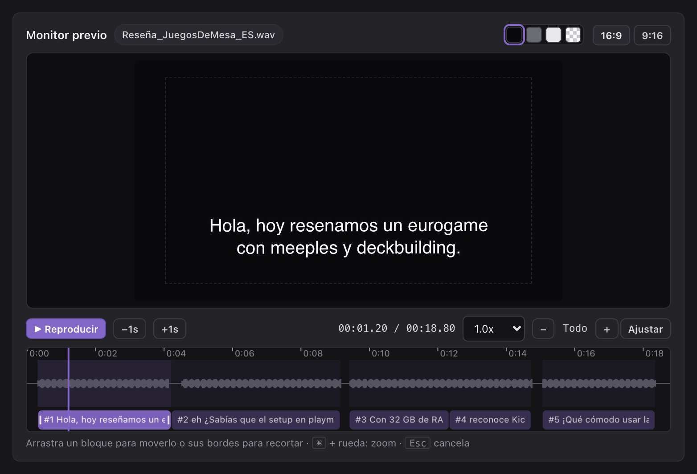
- Native DaVinci Resolve subtitle tracks (`ST`) disallow Fusion plugins and expressions, so MTTN AutoSubs Tool pairs custom flipbook typography with `AutoSubs_ES_Anitype_Animado` on a Video (`V`) track or sliced `FCPXML 1.9` Basic Titles.

### Colors, opacity, and saved styles

In **4. Estilo y tipografía > Colores y opacidad**, each layer (text, karaoke, outline, shadow, and box) has its own color and a 0–100 % opacity control:

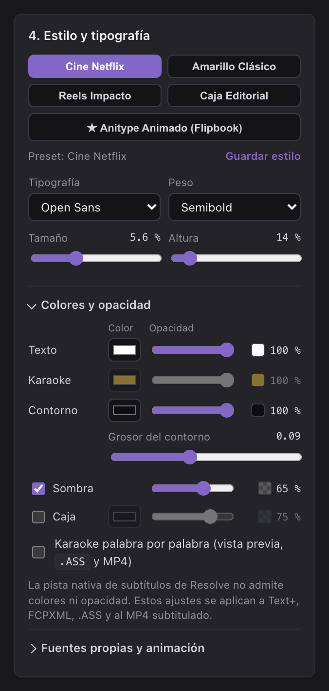

- **Text at 0 % with a visible outline** produces hollow lettering.
- A **box at 50–80 %** lets the video show through while staying readable.
- The **contrast** indicator warns when the text will be hard to read against its box or outline.
- Switch the **monitor background** (black, gray, light, or checkerboard) to judge transparency before exporting.
- Edited presets show **Restablecer** (reset). **Guardar estilo** saves your combinations as custom presets in this browser.

| Target | Opacity |
| :--- | :--- |
| Preview monitor, `.ASS`, and burned-in MP4 | All layers |
| `Text+` clips (Resolve Free and Studio) | Text, outline, shadow, and box |
| `FCPXML 1.9` | Text only; Resolve may ignore it on import |
| SRT, VTT, and the native subtitle track (`ST`) | Not applicable: these formats carry no styling |

### Insert subtitles into DaVinci Resolve 20

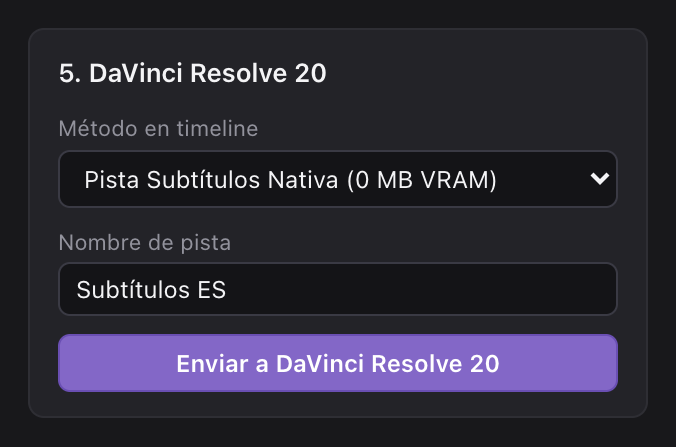

1. In **5. DaVinci Resolve 20**, select an insertion mode:
   - **Pista Subtítulos Nativa (0 MB VRAM)**: Adds a native `.srt` subtitle track for smooth 4K playback.
   - **Clips Text+ GPU-Light (1 nodo)**: Inserts Fusion `Text+` clips styled with Shading Elements, or cycles up to five font variants plus posterized jitter with `AutoSubs_ES_Anitype_Animado` (single active branch per frame). Before your first `Text+` push, drag one preset from **Effects** > **Titles** > **MTTN AutoSubs** into your **Media Pool**.
   - **FCPXML 1.9 Universal**: Exports and imports an `.fcpxml` timeline with Basic Titles (sliced automatically at frame holds when a multi-font pack is active).
2. Click **Enviar a DaVinci Resolve 20**.
3. If you use DaVinci Resolve 20 Free, click **Workspace** > **Scripts** > **2 - MTTN AutoSubs - Insertar Subtitulos** inside Resolve to place the subtitles onto your timeline.

## Package a standalone distribution archive

Build a clean, permission-preserving `MTTN_AutoSubs_Tool.zip` bundle for sharing across Macs:

```bash
python3 -B package_bundle.py --output ~/Downloads/MTTN_AutoSubs_Tool.zip
```

## Verify the installation locally

Run the included unit and HTTP integration test suite to verify the Spanish NLP formatter, board-game anglicism repairs, exporters, local server, templates, Lua bridge, and ZIP packager:

```bash
python3 -B autosubs_es_test.py -v
```

## License

Released under the [MIT License](LICENSE) — Copyright (c) 2026 [La Matatena](https://la-matatena.com).
