# MTTN AutoSubs Tool

> 🌐 **Español** | [English](README.en.md)

[](https://github.com/la-matatena/mttn-autosubs-tool/actions/workflows/ci-release.yml)
[](https://github.com/la-matatena/mttn-autosubs-tool/releases/latest)
[](LICENSE)
[](pyproject.toml)
[](docs/user-guide.md)
[](install_imac.sh)
[](https://github.com/la-matatena)

**MTTN AutoSubs Tool** (desarrollado por **[La Matatena](https://la-matatena.com)** · [@la-matatena](https://github.com/la-matatena)) permite a creadores y editores hispanohablantes generar subtítulos precisos de forma 100% local en macOS—ya sea como una aplicación de escritorio y CLI independiente, o sincronizada directamente con la línea de tiempo de DaVinci Resolve 20 (versiones Free y Studio)—sin enviar audio a servidores en la nube ni saturar la memoria VRAM de la tarjeta gráfica.

Está optimizado especialmente para equipos como la iMac 2017 Retina 4K (`Intel Core i5 Quad-Core a 3 GHz`, `32 GB RAM DDR4`, `2 GB VRAM AMD Radeon Polaris`) y Apple Silicon (`M1/M2/M3/M4`). Ejecuta modelos Whisper GGML de 8 bits y Large-v3 completo con persistencia de contexto, integrando corrección fonética automática para términos de juegos de mesa y anglicismos del mundo lúdico.

La interfaz de usuario sigue los estándares neutros de macOS tanto en modo oscuro como claro (superficies zinc/carbón y plata, con tipografía limpia y de alto contraste), reservando el morado distintivo de La Matatena (`#8367c7`) únicamente para botones de acción clave, selecciones activas y resaltados interactivos. Incluye además un selector en la barra superior para alternar entre **tema claro y oscuro**, sincronizado automáticamente con la preferencia del sistema.

> **Convención de Proyectos de La Matatena:** Todas las herramientas bajo [`github.com/la-matatena`](https://github.com/la-matatena) siguen la nomenclatura [**MTTN Standards**](https://github.com/la-matatena/.github/blob/main/CONVENTIONS.md) (**`MTTN` + `NombreDeDosPalabras` + `[Sufijo]`**, ej. **MTTN AutoSubs Tool**, **MTTN PaperCraft Studio**) y la paleta de identidad visual `#8367c7` / `#6a4fb3`.

## Vista previa de la interfaz

MTTN AutoSubs Tool organiza el flujo de trabajo en **6 pasos numerados** y permite alternar con un solo clic entre el **Modo DaVinci Resolve 20** y el **Modo App Independiente**:


*Estudio en 3 columnas en modo **DaVinci Resolve 20** con el modelo `Large-v3-Turbo Q8_0` seleccionado, temática **Juegos de Mesa + Anglicismos (BGG)** activa y reproducción sincronizada en el **Monitor previo**.*

El selector de modo está junto al título, en la barra superior:


Cada sección de esta página muestra de cerca la parte de la interfaz de la que habla.

## Documentación detallada

Consulta las guías completas para conocer los flujos de trabajo, ajustes de hardware, reglas RAE y resolución de problemas:

| Guía | Destinatarios | Contenido |
| :--- | :--- | :--- |
| [Guía de usuario](docs/user-guide.md) | Creadores y editores de video | Instalación en macOS, uso independiente y CLI, exportación MP4, flujo con DaVinci Resolve Free y Studio, estilos e inserción en timeline. |
| [Documento de diseño de ingeniería](docs/design-doc.md) | Desarrolladores y mantenedores | Arquitectura del sistema, límites de hardware, alternativas descartadas, especificación de subsistemas, seguridad CSRF en localhost y pruebas. |
| [Arquitectura y optimización para iMac 2017](docs/imac-2017-architecture.md) | Desarrolladores y técnicos | Diagrama de bloques, gobernador de CPU y VRAM, catálogo de modelos GGML para 32 GB, `--carry-initial-prompt`, IPC Lua para Resolve y API HTTP. |
| [Referencia de subtitulado en español](docs/spanish-subtitling-reference.md) | Editores y transcriptores | Correcciones de jerga lúdica y anglicismos, prompts dialectales, reparación de UTF-8 y BPE, signos de puntuación invertidos (`¿`, `¡`) y división de líneas según la RAE. |
| [Guía de resolución de problemas](docs/troubleshooting.md) | Editores de video | Permisos de Gatekeeper en macOS, detección de binarios de Homebrew, importación manual de SRT, configuración de `Text+` en Media Pool y gestión de 2 GB de VRAM. |

## Optimización de hardware para iMac Retina 4K 2017 y Apple Silicon

Cada fase del proceso está calibrada para aprovechar al máximo una iMac 2017 (Retina 4K, 21.5") con Intel Core i5 Quad-Core a 3 GHz (`x86_64` AVX2), GPU AMD Radeon Polaris de 2 GB VRAM, 32 GB RAM DDR4 y macOS 15+, funcionando igualmente de forma ultra veloz en procesadores Apple Silicon (`M1/M2/M3/M4`):

| Componente | Configuración | Beneficio |
| :--- | :--- | :--- |
| Motor de transcripción | `whisper-cpp` nativo (`whisper-cli`) | Binarios compilados en C++ con AVX2 o ARM Neon, sin dependencias complejas de Python ni caídas de `ctranslate2`. |
| Protección de GPU | Forzado del parámetro `--no-gpu` (`-ng`) en Polaris | Mantiene 0 MB de carga en la GPU Radeon de 2 GB, evitando fallos de memoria en DaVinci Resolve 20 y WindowServer durante reproducción en 4K. |
| Asignación de memoria | Modelo por defecto `ggml-large-v3-turbo-q8_0.bin` (1.55 GB RAM) | Aprovecha los 32 GB de RAM para ofrecer cuantización de 8 bits casi sin pérdida a la velocidad de la arquitectura Turbo. |
| Persistencia de contexto | Detección automática de `--carry-initial-prompt` con `-mc 64` | Mantiene el vocabulario de juegos de mesa y la puntuación correcta en español a lo largo de cada ventana de 30 segundos en videos largos. |
| Gobernador de CPU | 3 hilos con `nice -n 10` cuando Resolve está abierto (4 hilos en independiente) | Aprovecha toda la potencia del procesador en modo independiente mientras reserva 1 núcleo cuando DaVinci Resolve está en uso para no congelar la edición. |
| Renderizado de video | SRT nativo, quemado MP4 con `libx264` en CPU o títulos vectoriales `Text+` | Quema subtítulos en MP4 puramente por CPU con 0 MB de VRAM, o genera títulos vectoriales en DaVinci Resolve con total fluidez. |

### Perfiles de hardware detectados automáticamente

Al arrancar, la app detecta el equipo y elige un perfil (visible en el paso **2. Motor Whisper** y en las insignias de la barra superior):

| Perfil | GPU para Whisper | Hilos (solo / con Resolve) | Codificador MP4 |
| :--- | :--- | :--- | :--- |
| **Mac Intel** (como la iMac 2017) | Desactivada (`-ng`) para proteger GPUs con poca VRAM | Según los núcleos reales (iMac 2017: 4 / 3) | `libx264` (CPU) |
| **Apple Silicon** (M1–M4 y posteriores) | **Metal activado** | Núcleos de rendimiento, máx. 8 / reserva núcleos para Resolve | `h264_videotoolbox` (motor de vídeo por hardware) |

Puedes forzar un perfil con la variable de entorno `AUTOSUBS_HW_PROFILE=intel_imac2017` o `AUTOSUBS_HW_PROFILE=apple_silicon` (útil para simular la iMac 2017 en otra Mac).

### Rendimiento de esta Mac (⚙ Esta Mac)

El botón de estado de la barra superior (⚙ con el procesador, la GPU y el estado de Resolve) abre un panel con el equipo detectado y los ajustes de rendimiento. Se guardan **solo en esa Mac** (`~/Library/Application Support/AutoSubsES/settings.json`), así que la iMac puede quedarse en modo seguro mientras una MacBook usa todo su potencial:


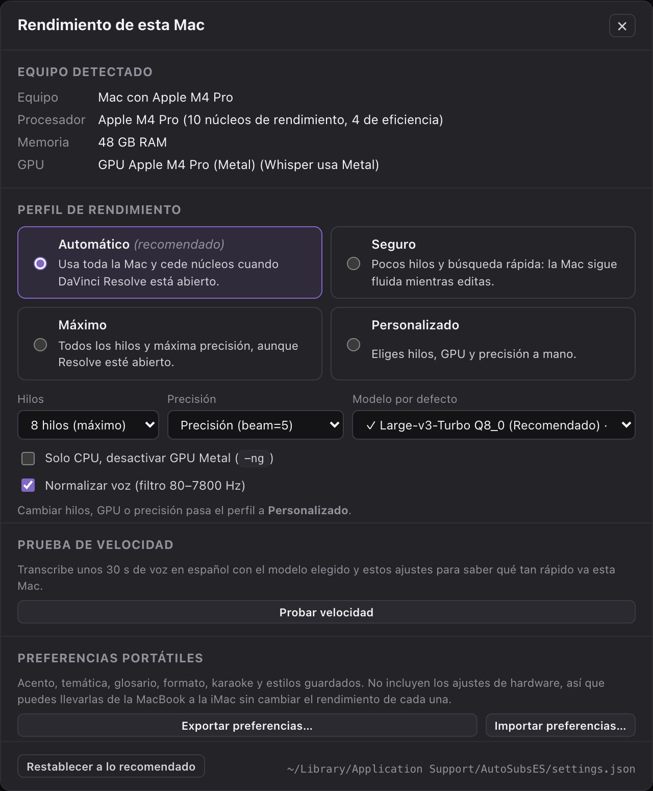

- **Perfil**: **Automático** (recomendado: usa toda la Mac y cede núcleos cuando Resolve está abierto), **Seguro** (pocos hilos y búsqueda rápida para editar sin tirones), **Máximo** o **Personalizado** (hilos, GPU y precisión a mano). El paso 2 muestra un resumen del perfil activo (por ejemplo, `8 hilos · GPU · precisión`) y el enlace **Ajustar…** para abrir este panel.
- **Modelo por defecto** de esa Mac y **Restablecer a lo recomendado**.
- **Probar velocidad**: transcribe unos 30 s de voz en español (voz del sistema) con el modelo elegido y muestra cuántas veces más rápido que el tiempo real va, con una recomendación de modelo. Referencia: en una MacBook Pro M4 Pro, `turbo-q8` va entre 6× y 20× más rápido que el tiempo real con Metal (según si el modelo ya está en memoria) y unas 4× solo con CPU.
- **Exportar / Importar preferencias**: acento, temática, glosario, formato, karaoke y estilos guardados en un `.json` para llevarlos a otra Mac **sin** copiar los ajustes de hardware.

El acento, la temática, el glosario y el formato también se recuerdan entre sesiones.

## Catálogo de modelos Whisper en español

Tener suficiente memoria RAM (como los 32 GB de la iMac 2017 o los chips Apple Silicon) elimina los cuellos de botella de memoria. Puedes descargar cualquiera de los modelos directamente desde el paso **2. Motor Whisper** con soporte de reanudación automática:

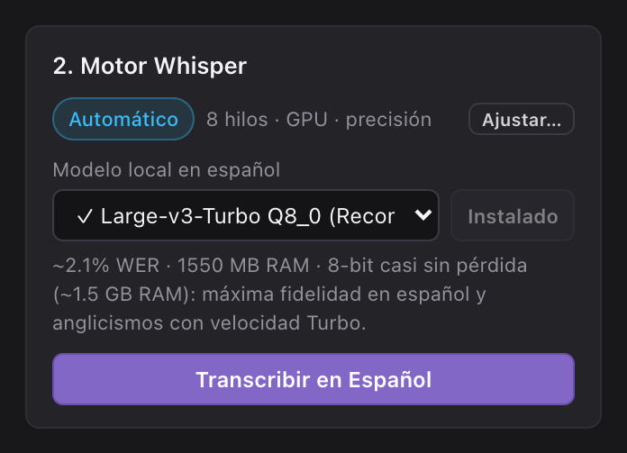

| ID del modelo | Archivo | Tamaño de descarga | RAM máxima | WER aprox. en español | Caso de uso recomendado |
| :--- | :--- | :--- | :--- | :--- | :--- |
| `turbo-q8` | `ggml-large-v3-turbo-q8_0.bin` | 834 MB | 1,550 MB | 2.1% | **Recomendado por defecto:** precisión casi idéntica a FP16 con cuantización de 8 bits y velocidad Turbo de 4 capas. |
| `large-v3-q5` | `ggml-large-v3-q5_0.bin` | 1,080 MB | 2,100 MB | 1.9% | Máxima precisión posible en español y términos bilingües con el decodificador completo de 32 capas cuando el tiempo no apremia. |
| `turbo-q5` | `ggml-large-v3-turbo-q5_0.bin` | 547 MB | 1,100 MB | 2.3% | Alternativa balanceada de 5 bits para transcripción rápida en episodios extensos. |
| `small-q8` | `ggml-small-q8_0.bin` | 252 MB | 650 MB | 5.2% | Borradores rápidos y primeros cortes de edición en 3 o 4 hilos de CPU. |
| `base-q8` | `ggml-base-q8_0.bin` | 82 MB | 320 MB | 8.2% | Validación rápida de tuberías o entornos con conexión a internet muy limitada. |

## Vocabulario especializado de juegos de mesa y anglicismos (`juegos_mesa`)

En los canales y contenidos de juegos de mesa en español es habitual mezclar términos en inglés, nombres de editoriales, mecánicas y pronunciaciones castellanizadas. MTTN AutoSubs Tool combina el selector **Temática y anglicismos** (`Juegos de Mesa + Anglicismos (BGG)` por defecto) con cualquier **Acento regional** (`Español Neutro`, `España (Peninsular)`, `México / LatAm` o `Río de la Plata`):

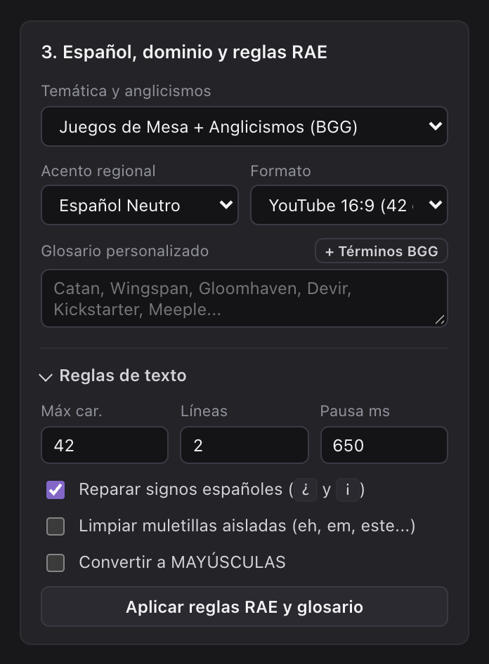

- **Condicionamiento continuo de Whisper**: `build_spanish_initial_prompt` alimenta el prompt de `whisper-cli` con términos lúdicos esenciales (`BoardGameGeek`, `BGG`, `eurogame`, `ameritrash`, `meeples`, `deckbuilding`, `worker placement`, `set collection`, `draft`, `setup`, `playmat`, `downtime`, `kingmaking`, `alpha player`, `filler`, `gateway`, `Kickstarter`, `Gamefound`) más los términos de tu **Glosario personalizado**, manteniéndolos activos en todo el video mediante `--carry-initial-prompt`.
- **Reparación fonética determinista**: `BOARDGAME_PHONETIC_FIXES` corrige de inmediato más de 70 errores fonéticos frecuentes de Whisper en español tras la transcripción—por ejemplo convirtiendo `eurogueim` en `eurogame`, `mipels` en `meeples`, `dec bilding` en `deckbuilding`, `setap` en `setup`, `pleimat` en `playmat`, `dauntaim` en `downtime`, `worker pleisment` en `worker placement`, `kikstarter` en `Kickstarter` y `be ge ge` en `BGG`—respetando siempre las mayúsculas y minúsculas correctas.
- **Puntuación respetuosa con muletillas**: `_repair_inverted_spanish_punctuation` detecta titubeos y muletillas iniciales (`eh`, `em`, `mm`) antes de colocar los signos de apertura `¿` o `¡`, convirtiendo frases como `eh Sabías... ?` en `eh ¿Sabías...?` antes de ejecutar la limpieza opcional de muletillas.

## Instalación en macOS

El instalador configura automáticamente las herramientas `whisper-cpp`, `ffmpeg` y `ffmpeg-full` (necesario para quemar subtítulos en MP4, porque incluye `libass`) mediante Homebrew, crea el paquete de aplicación nativo `~/Applications/MTTN AutoSubs Tool.app`, instala los scripts Lua y plantillas Fusion para DaVinci Resolve 20, y descarga el modelo predeterminado `ggml-large-v3-turbo-q8_0.bin`:

1. Abre **Terminal** y clona o ingresa a la carpeta del repositorio:

   ```bash
   git clone https://github.com/la-matatena/mttn-autosubs-tool.git
   cd mttn-autosubs-tool
   ```

2. Ejecuta el script de instalación:

   ```bash
   ./install_imac.sh
   ```

   *Opcional:* Puedes pasar `--model=large-v3-q5` para descargar directamente el modelo de máxima precisión de 32 capas, o `--skip-model` si prefieres descargarlo después desde la interfaz.

3. Abre **MTTN AutoSubs Tool** desde tu carpeta de **Aplicaciones** (`~/Applications/MTTN AutoSubs Tool.app`) o haz doble clic en `Iniciar AutoSubs ES.command`. Se abre en **su propia ventana de macOS** (con icono en el Dock y diálogo nativo de «Guardar como…» al exportar); al cerrar la ventana se detiene el servidor local. El instalador prepara esa ventana con `pywebview` en un entorno aislado (`~/Library/Application Support/AutoSubsES/venv`); si no está disponible, la app se abre en Chrome, Brave o Safari.

   Desde Terminal también puedes usar:

   ```bash
   python3 -B autosubs_server.py --app-window   # ventana de Chrome/Brave
   python3 -B autosubs_server.py                # pestaña del navegador
   ```

## Uso en Modo Independiente (Standalone) o CLI

No es obligatorio tener DaVinci Resolve abierto ni instalado para subtitular videos, entrevistas, podcasts o reseñas:

1. Selecciona **App Independiente** en el selector de modo de la barra superior (el sistema también activa este modo automáticamente si abres la app y DaVinci Resolve no está en ejecución).
2. Arrastra cualquier archivo de audio o video local (`.wav`, `.mp3`, `.m4a`, `.mp4`, `.mov` o `.mkv`) sobre la zona de carga en **1. Audio de origen**. Los videos se reproducen de inmediato en el **Monitor previo** con subtítulos sincronizados cuadro por cuadro y barra de desplazamiento de audio.

   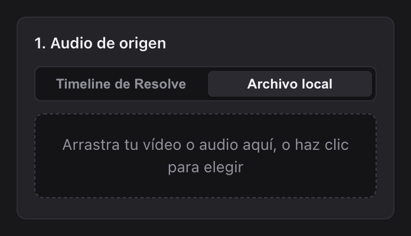
3. Ajusta las opciones en **2. Motor Whisper** y **3. Español, dominio y reglas RAE**, y haz clic en **Transcribir en Español**.
4. Exporta tus resultados desde la tarjeta **6. Exportar**. **.SRT Estándar** y **Render MP4** están a la vista; el resto de formatos y **Copiar guion** están en **Más formatos**:

   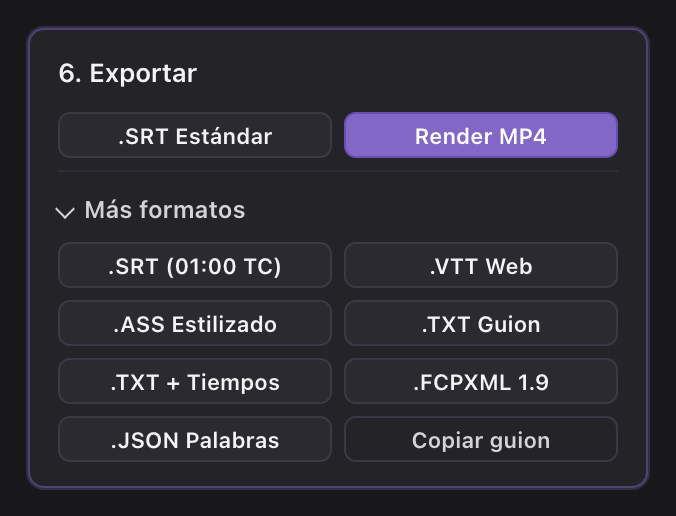

   - **Archivos de subtítulos**: Descarga `.SRT Estándar`, `.SRT (01:00 TC)`, `.VTT Web`, `.ASS Estilizado`, `.FCPXML 1.9` o `.JSON Palabras`.
   - **Guiones limpios y transcripciones**: Exporta `.TXT Guion` (texto continuo en párrafos limpios), `.TXT + Tiempos` (guion con marcas de tiempo para revisión) o copia todo el texto al portapapeles con **Copiar guion**.
   - **Video MP4 con subtítulos integrados**: Haz clic en **Render MP4** para codificar un video H.264 `.mp4`: con `libx264` en el procesador (0 MB de VRAM) en Mac Intel, o con `h264_videotoolbox` por hardware en Apple Silicon. Requiere `ffmpeg-full` (`brew install ffmpeg-full`).
   - **Karaoke palabra por palabra**: está **apagado por defecto**. Actívalo en **4. Estilo y tipografía** para resaltar cada palabra en la vista previa, el `.ASS` y el MP4. Al editar el texto, las palabras que se mantienen conservan sus tiempos de Whisper y las nuevas se reparten el tiempo restante.

### Transcripción por línea de comandos (CLI sin interfaz)

También puedes transcribir archivos de audio y video directamente desde la terminal hacia archivos `.srt`, `.vtt`, `.ass`, `.txt` y `.json`:

```bash
python3 -B autosubs_server.py \
  --cli ARCHIVO_DE_ENTRADA \
  --model turbo-q8 \
  --dialect neutro \
  --domain juegos_mesa \
  --output-srt RUTA_SALIDA_SRT
```

Parámetros a sustituir:

- `ARCHIVO_DE_ENTRADA`: ruta al archivo de audio o video que deseas transcribir.
- `RUTA_SALIDA_SRT`: ruta donde se guardará el archivo de subtítulos `.srt` resultante.

## Uso sincronizado con DaVinci Resolve 20

Selecciona **DaVinci Resolve 20** en la barra superior cuando desees una integración bidireccional directa con DaVinci Resolve 20 Free o DaVinci Resolve 20 Studio. Para más detalles, consulta la [guía de usuario](docs/user-guide.md).

### 1. Exportar audio desde la línea de tiempo

1. Abre tu proyecto y línea de tiempo activa en DaVinci Resolve 20.
2. En la barra de menús superior de DaVinci Resolve, haz clic en **Workspace** > **Scripts** > **1 - MTTN AutoSubs - Exportar Audio** (o pulsa **Exportar audio (Studio)** directamente en la interfaz de AutoSubs si tienes Resolve Studio).
3. Cuando la consola de Resolve confirme la exportación del audio, regresa a MTTN AutoSubs Tool y presiona **Leer buzón**.

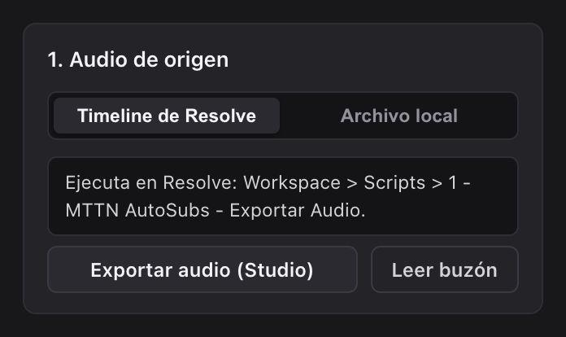

### 2. Transcribir y editar subtítulos en español

1. En **3. Español, dominio y reglas RAE**, selecciona **Juegos de Mesa + Anglicismos (BGG)** (o **General / Documental** / **Tech y Edición Vídeo**) junto con el **Acento regional** que corresponda (`Español Neutro`, `España`, `México / LatAm` o `Río de la Plata`).
2. Agrega nombres de juegos, editoriales o términos propios en **Glosario personalizado**, o pulsa **+ Términos BGG** para cargar un vocabulario lúdico inicial.
3. Haz clic en **Transcribir en Español**, y revisa los subtítulos en el **Monitor previo** y en el editor central (`÷` para dividir, `+Unir`, `×` para eliminar, etiquetas de CPS e indicador de **Aplicar reglas RAE y glosario**).

   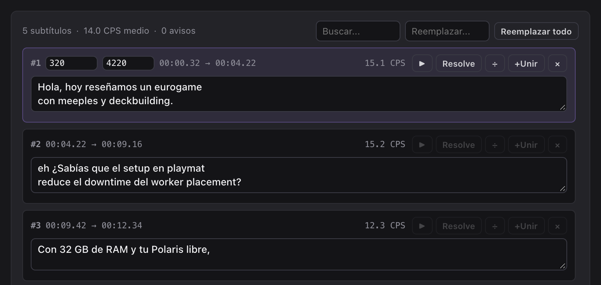

4. Ajusta los tiempos directamente en la **forma de onda**: arrastra un bloque morado para moverlo o sus bordes para cambiar inicio y fin (`Esc` cancela). Usa `+`/`−`, ⌘ + rueda o el pellizco del trackpad para hacer zoom, y la rueda para desplazarte cuando hay zoom.

   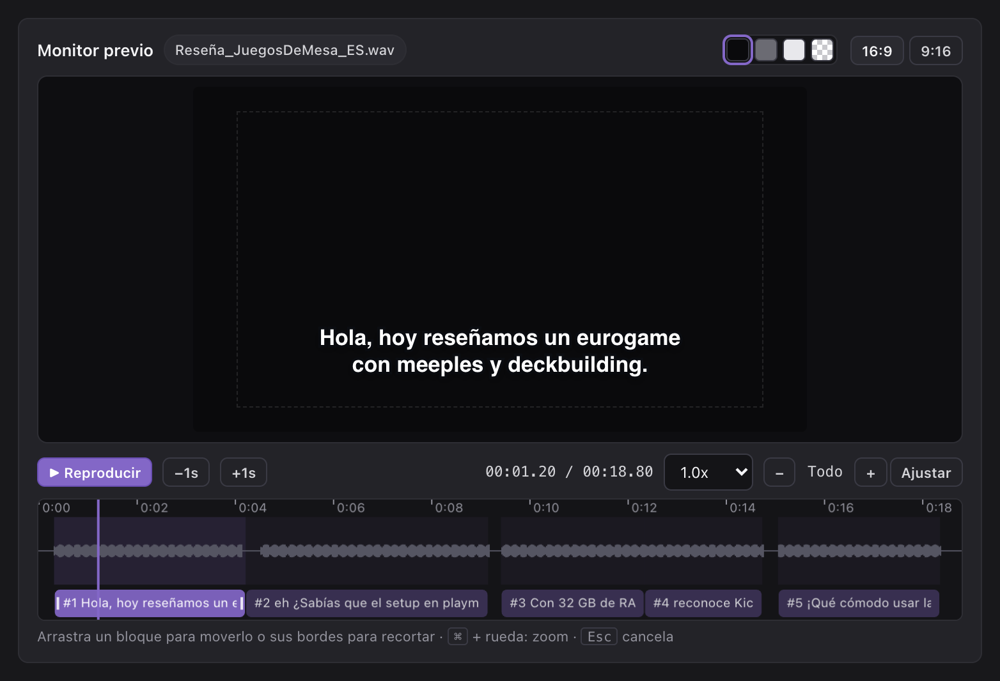

### 3. Tipografías personalizadas y paquetes animados

Arrastra fuentes `.otf`, `.ttf`, `.ttc` o archivos comprimidos `.zip` en **4. Estilo y tipografía** para verlas en el **Monitor previo** e instalarlas en `~/Library/Fonts` para DaVinci Resolve:

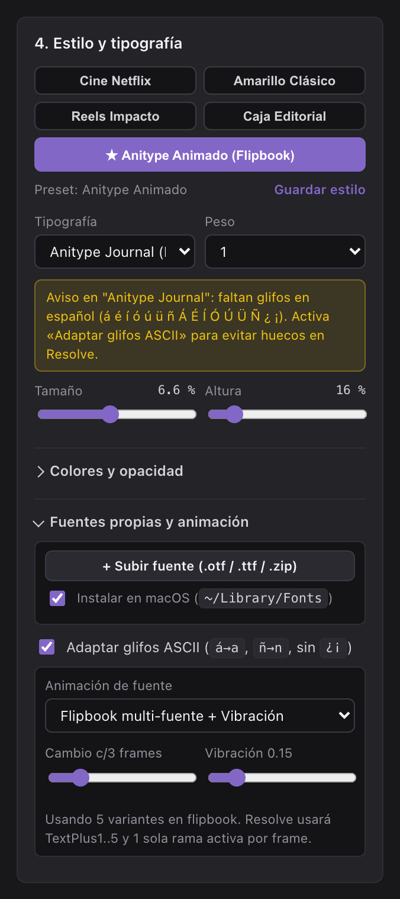

- Los paquetes con variantes numeradas (como el set de cinco fuentes de `Anitype Journal`) se agrupan automáticamente bajo una sola opción en **Packs animados (Flipbook)**.
- Si una fuente carece de caracteres en español (`á`, `é`, `í`, `ó`, `ú`, `ü`, `ñ`, `¿`, `¡`), el sistema muestra una advertencia y ofrece el interruptor **Adaptar glifos ASCII** para que `Text+` muestre palabras completas en lugar de caracteres vacíos. En el **Monitor previo** verás el resultado (por ejemplo, «reseñamos» pasa a «resenamos»), mientras el editor conserva el texto original:

  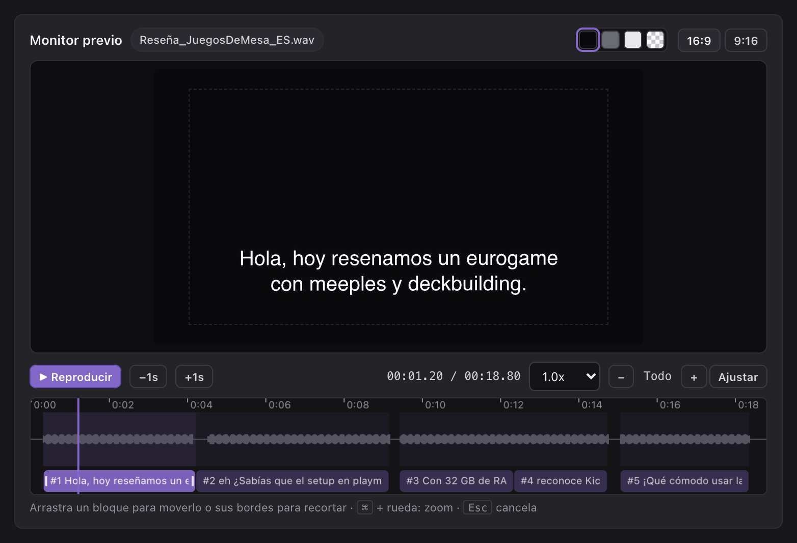
- Las pistas de subtítulos nativas de DaVinci Resolve (`ST`) no admiten plugins ni expresiones de Fusion; por ello, MTTN AutoSubs Tool conecta los estilos animados con `AutoSubs_ES_Anitype_Animado` en una pista de video estándar (`V`) o genera títulos básicos cortados mediante `FCPXML 1.9`.

### Colores, opacidad y estilos propios

En **4. Estilo y tipografía > Colores y opacidad**, cada capa (texto, karaoke, contorno, sombra y caja) tiene su propio color y un control de opacidad de 0 a 100 %:

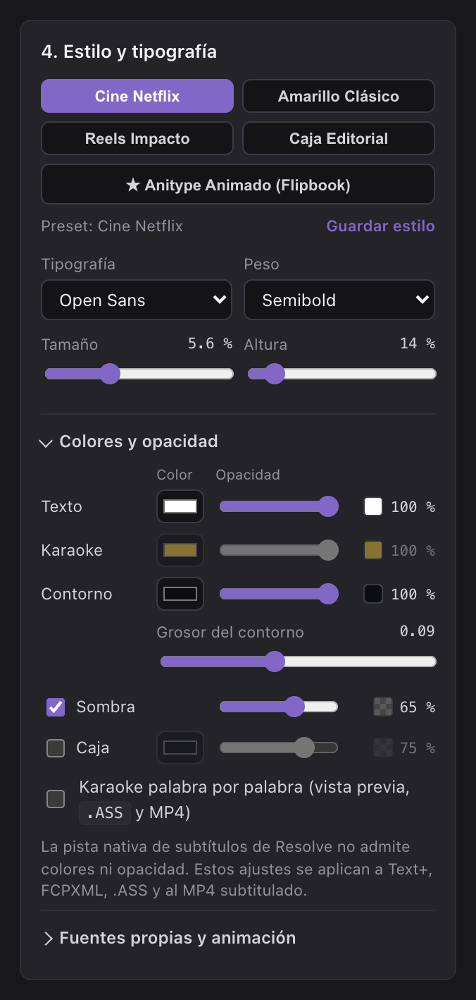

- **Texto al 0 % con contorno visible** produce letras huecas (*outline*).
- Una **caja al 50–80 %** deja ver el vídeo detrás sin perder legibilidad.
- El indicador de **contraste** avisa cuando el texto se va a leer mal sobre su caja o contorno.
- Cambia el **fondo del monitor** (negro, gris, claro o cuadrícula) para evaluar la transparencia antes de exportar.
- Si modificas un preset, aparece **Restablecer**. Con **Guardar estilo** guardas tus combinaciones como presets propios en este navegador.

| Destino | Opacidad |
| :--- | :--- |
| Monitor previo, `.ASS` y MP4 subtitulado | Todas las capas |
| Clips `Text+` (Resolve Free y Studio) | Texto, contorno, sombra y caja |
| `FCPXML 1.9` | Solo el texto; Resolve podría ignorarla al importar |
| SRT, VTT y pista nativa de subtítulos (`ST`) | No aplica: estos formatos no guardan estilo |

### 4. Insertar los subtítulos en DaVinci Resolve 20

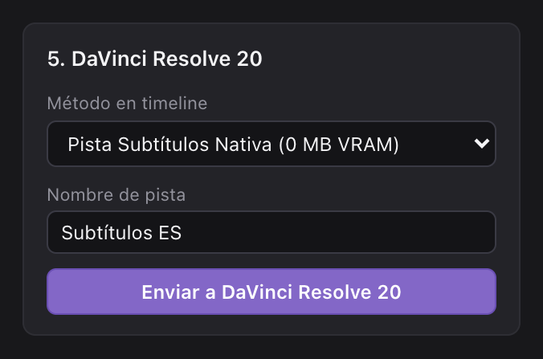

1. En **5. DaVinci Resolve 20**, elige el modo de inserción que prefieras:
   - **Pista Subtítulos Nativa (0 MB VRAM)**: Agrega una pista `.srt` nativa de DaVinci Resolve, ideal para reproducción fluida en 4K.
   - **Clips Text+ GPU-Light (1 nodo)**: Inserta clips Fusion `Text+` con estilos avanzados, o anima hasta 5 variantes tipográficas con vibración controlada usando `AutoSubs_ES_Anitype_Animado` (con una sola rama activa por cuadro). Antes de tu primer envío con `Text+`, arrastra una plantilla desde **Effects** > **Titles** > **MTTN AutoSubs** hacia tu **Media Pool**.
   - **FCPXML 1.9 Universal**: Genera e importa un archivo `.fcpxml` con títulos básicos (divididos automáticamente según los fotogramas de retención de cada fuente animada).
2. Haz clic en **Enviar a DaVinci Resolve 20**.
3. Si utilizas la versión gratuita (DaVinci Resolve Free), haz clic en **Workspace** > **Scripts** > **2 - MTTN AutoSubs - Insertar Subtitulos** en el menú de DaVinci Resolve para colocar los subtítulos en la línea de tiempo.

## Generar paquete de distribución ZIP

Crea un archivo comprimido limpio `MTTN_AutoSubs_Tool.zip` preservando los permisos de ejecución para compartirlo entre diferentes equipos Mac:

```bash
python3 -B package_bundle.py --output ~/Downloads/MTTN_AutoSubs_Tool.zip
```

## Verificación de pruebas locales

Ejecuta la suite completa de pruebas unitarias y de integración HTTP para comprobar el procesador de lenguaje español, la corrección de jerga lúdica, los exportadores, el servidor web local, las plantillas Fusion, los scripts Lua y el generador de paquetes ZIP:

```bash
python3 -B autosubs_es_test.py -v
```

## Licencia

Publicado bajo la [Licencia MIT](LICENSE) — Copyright (c) 2026 [La Matatena](https://la-matatena.com).
