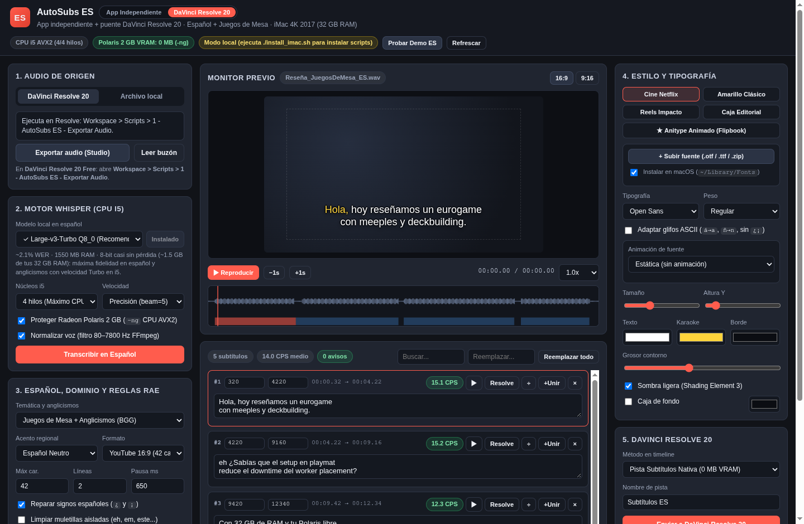
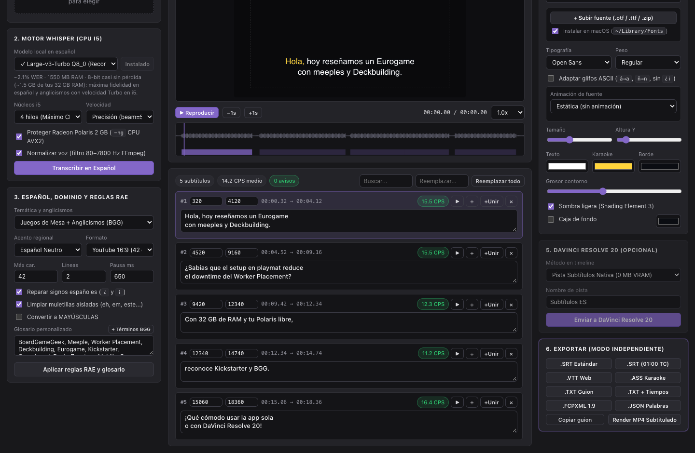
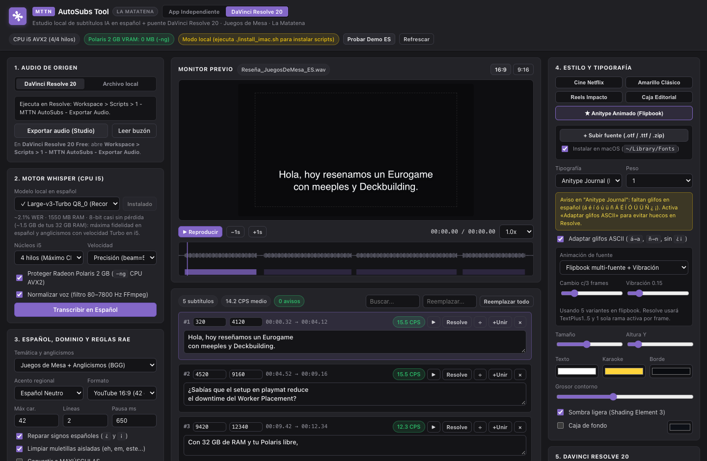

<!-- go/g3mark-in-g3doc -->

## MTTN AutoSubs Tool 

MTTN AutoSubs helps Spanish-language creators generate accurate subtitles locally on macOS—either as a standalone desktop and CLI studio or paired directly with DaVinci Resolve 20 Free and Studio—without sending audio to cloud servers or exhausting GPU VRAM. It ships tuned for a 2017 Retina 4K iMac (`3 GHz Quad-Core Intel Core i5`, `32 GB DDR4 RAM`, `2 GB AMD Radeon Polaris VRAM`), runs persistent-prompt 8-bit and full Large-v3 Whisper models, and recognizes Spanish board-game terms and anglicisms out of the box.

## Interface preview

MTTN AutoSubs adapts the workflow for standalone local video subtitling, DaVinci Resolve 20 timeline insertion, and animated custom font packs:



*Three-column studio in **DaVinci Resolve 20** mode with `Large-v3-Turbo Q8_0` selected, **Juegos de Mesa + Anglicismos (BGG)** active, and live Spanish karaoke rendering in **Monitor previo**.*



***App Independiente** mode applying the **Juegos de Mesa + Anglicismos (BGG)** glossary and phonetic repair (`Eurogame`, `meeples`, `Deckbuilding`, `playmat`, `Worker Placement`, `Kickstarter`, `BGG`) alongside standalone `.TXT`, `.SRT`, `.VTT`, `.ASS`, `.FCPXML`, `.JSON`, and burned-in `.MP4` exports.*



***Anitype Journal** five-font flipbook animation controls paired with OpenType `cmap` Spanish glyph detection and non-destructive ASCII adaptation for `Text+` templates.*

## Documentation

Read the detailed guides for workflows, hardware tuning, Spanish RAE rules, and troubleshooting:

| Guide | Audience | Coverage |
| :--- | :--- | :--- |
| [User guide](docs/user-guide.md) | Video editors and creators | macOS app installation, standalone CLI and MP4 export, Resolve Free and Studio audio export, styling, and timeline insertion. |
| [Engineering design document](docs/design-doc.md) | Engineers and maintainers | System design, hardware constraints, rejected alternatives, subsystem specifications, localhost CSRF guards, and verification strategy. |
| [Architecture and 2017 iMac tuning](docs/imac-2017-architecture.md) | Developers and technical editors | System diagram, CPU and VRAM governor, 32 GB GGML model catalog, `--carry-initial-prompt`, Resolve Lua IPC, and HTTP API endpoints. |
| [Spanish subtitling reference](docs/spanish-subtitling-reference.md) | Editors and localization teams | Board-game domain and anglicism repairs, dialect prompts, BPE and UTF-8 repair, inverted punctuation repair, and RAE weak-ending wrapping. |
| [Troubleshooting guide](docs/troubleshooting.md) | Video editors | Gatekeeper permissions, Homebrew binary detection, manual SRT import, Media Pool `Text+` setup, and 2 GB VRAM tips. |

## Hardware optimization for the 2017 Retina 4K iMac

Every processing step is tuned for a 2017 iMac (Retina 4K, 21.5-inch) with a 3 GHz Quad-Core Intel Core i5 (`x86_64` AVX2), AMD Radeon Polaris 2 GB VRAM, 32 GB 2400 MHz DDR4 RAM, and macOS 15.8.1:

| Component | Configuration | Benefit |
| :--- | :--- | :--- |
| Inference engine | Native `whisper-cpp` (`whisper-cli`) | Runs compiled `x86_64` AVX2 binaries natively without missing `ctranslate2` Intel wheels. |
| GPU protection | Enforces the `--no-gpu` (`-ng`) flag | Keeps 0 MB load on the 2 GB Radeon Polaris GPU so macOS WindowServer and DaVinci Resolve 20 avoid VRAM errors during 4K playback. |
| Memory allocation | `ggml-large-v3-turbo-q8_0.bin` default (`1.55 GB` RAM) | Takes advantage of your 32 GB DDR4 RAM for near-lossless 8-bit quantization without sacrificing Turbo speed. |
| Prompt persistence | Auto-detects `--carry-initial-prompt` with `-mc 64` | Preserves Spanish punctuation and board-game vocabulary conditioning across every 30-second window of long videos. |
| CPU thread governor | `3` threads with `nice -n 10` when Resolve runs (`4` standalone) | Uses full Core i5 throughput in standalone mode while reserving 1 core whenever DaVinci Resolve 20 is open. |
| Timeline rendering | Native SRT, CPU `libx264` MP4 burn-in, or GPU-light `Text+` | Burns standalone MP4 files on CPU with 0 MB VRAM, or renders native 3840x2160 vector Resolve titles safely. |

## Spanish Whisper models for 32 GB RAM

Your 32 GB DDR4 memory pool removes RAM bottlenecks for larger quantized GGML models. Download models inside **2. Motor Whisper (CPU i5)** with automatic HTTP resume support:

| Model ID | Filename | Download size | Peak RAM | Approximate Spanish WER | Recommended role |
| :--- | :--- | :--- | :--- | :--- | :--- |
| `turbo-q8` | `ggml-large-v3-turbo-q8_0.bin` | 834 MB | 1,550 MB | 2.1% | Default recommended choice: 8-bit near-lossless Spanish and anglicism accuracy with 4-layer Turbo speed. |
| `large-v3-q5` | `ggml-large-v3-q5_0.bin` | 1,080 MB | 2,100 MB | 1.9% | Maximum Spanish and bilingual board-game accuracy with a full 32-layer decoder when speed is secondary. |
| `turbo-q5` | `ggml-large-v3-turbo-q5_0.bin` | 547 MB | 1,100 MB | 2.3% | Balanced 5-bit Turbo alternative for long episodes that prioritize faster turnaround. |
| `small-q8` | `ggml-small-q8_0.bin` | 252 MB | 650 MB | 5.2% | Fast rough cuts and quick dialogue drafts on 3 or 4 CPU threads. |
| `base-q8` | `ggml-base-q8_0.bin` | 82 MB | 320 MB | 8.2% | Lightweight pipeline validation when bandwidth is constrained. |

## Board-game vocabulary and anglicisms (`juegos_mesa`)

Spanish board-game channels mix regional Spanish grammar with English mechanics, publisher names, and Hispanicized pronunciations. MTTN AutoSubs pairs **Temática y anglicismos** (`Juegos de Mesa + Anglicismos (BGG)` by default) with any regional **Acento regional** (`Español Neutro`, `España (Peninsular)`, `México / LatAm`, or `Río de la Plata`):

-   **Persistent Whisper conditioning**: `build_spanish_initial_prompt` seeds `whisper-cli --prompt` with domain terms (`BoardGameGeek`, `BGG`, `eurogame`, `ameritrash`, `meeples`, `deckbuilding`, `worker placement`, `set collection`, `draft`, `setup`, `playmat`, `downtime`, `kingmaking`, `alpha player`, `filler`, `gateway`, `Kickstarter`, `Gamefound`) plus your **Glosario personalizado** and keeps them active across the whole timeline when `whisper-cli` supports `--carry-initial-prompt`.
-   **Deterministic phonetic repair**: `BOARDGAME_PHONETIC_FIXES` corrects ~70 common Spanish Whisper phonetic mistakes after transcription—for example turning `eurogueim` into `eurogame`, `mipels` into `meeples`, `dec bilding` into `deckbuilding`, `setap` into `setup`, `pleimat` into `playmat`, `dauntaim` into `downtime`, `worker pleisment` into `worker placement`, `kikstarter` into `Kickstarter`, and `be ge ge` into `BGG`—while preserving case-insensitive custom glossary overrides from **+ Términos BGG**.
-   **Hesitation-aware punctuation**: `_repair_inverted_spanish_punctuation` skips leading hesitations (`eh`, `em`, `mm`) before inserting `¿` or `¡`, turning `eh Sabías... ?` into `eh ¿Sabías...?` before optional filler cleanup runs.

## Install MTTN AutoSubs on macOS

The installer sets up the `whisper-cpp` and `ffmpeg` packages through Homebrew, creates the standalone `~/Applications/MTTN AutoSubs.app` macOS application bundle, copies the DaVinci Resolve 20 Lua bridge scripts and Fusion templates, and downloads the default `ggml-large-v3-turbo-q8_0.bin` Spanish model.

1.  Open **Terminal** and change to the `autosubs_es` directory:

    ```bash
    cd AUTOSUBS_DIR
    ```

    Replace the following:

    -   `AUTOSUBS_DIR`: the directory where you saved MTTN AutoSubs.

2.  Run the installer script:

    ```bash
    ./install_imac.sh
    ```

    Optional: Pass `--model=large-v3-q5` to download the full 32-layer maximum-accuracy Spanish model instead, or pass `--skip-model` to download models later inside the UI.

3.  Launch **MTTN AutoSubs** from **Applications** (`MTTN AutoSubs.app`), double-click `Iniciar MTTN AutoSubs.command`, or run the server from Terminal:

    ```bash
    python3 -B autosubs_server.py --app-window
    ```

## Run as a standalone macOS application or CLI

You do not need DaVinci Resolve open or installed to subtitle videos, interviews, or board-game reviews:

1.  Switch the top bar to **App Independiente** (the studio also selects this mode automatically on standalone app launches or when DaVinci Resolve is not running).
2.  Drag any local audio or video file (`.wav`, `.mp3`, `.m4a`, `.mp4`, `.mov`, or `.mkv`) onto the upload zone in **1. Audio de origen**. Video uploads stream directly inside **Monitor previo** with frame-accurate Spanish subtitles and audio scrubbing.
3.  Configure **2. Motor Whisper (CPU i5)** (`Large-v3-Turbo Q8_0` or `Large-v3 Completo Q5_0`) and **3. Español, dominio y reglas RAE**, then click **Transcribir en Español**.
4.  Export from **6. Exportar (Modo Independiente)**:
    -   **Subtitle files**: Download `.SRT Estándar`, `.SRT (01:00 TC)`, `.VTT Web`, `.ASS Karaoke`, `.FCPXML 1.9`, or `.JSON Palabras`.
    -   **Clean scripts and copy**: Export `.TXT Guion` (plain prose paragraphs), `.TXT + Tiempos` (timestamped review transcript), or copy the script to your clipboard with **Copiar guion**.
    -   **Burned-in MP4 video**: Click **Render MP4 Subtitulado** to encode an H.264 `.mp4` video with `libx264` CPU encoding and zero GPU Polaris VRAM pressure.

### Headless CLI transcription

Transcribe local media files directly from Terminal into `.srt`, `.vtt`, `.ass`, `.txt`, and `.json` files without launching the browser UI:

```bash
python3 -B autosubs_server.py \
  --cli INPUT_MEDIA \
  --model turbo-q8 \
  --dialect neutro \
  --domain juegos_mesa \
  --output-srt OUTPUT_SRT
```

Replace the following:

-   `INPUT_MEDIA`: the local audio or video file path to transcribe.
-   `OUTPUT_SRT`: the destination path for the formatted Spanish `.srt` subtitle file.

## Use MTTN AutoSubs with DaVinci Resolve 20

Switch the top bar to **DaVinci Resolve 20** whenever you want round-trip timeline integration with DaVinci Resolve 20 Free or DaVinci Resolve 20 Studio. See the [user guide](docs/user-guide.md) for detailed instructions.

### Export timeline audio

1.  Open your project and target timeline in DaVinci Resolve 20.
2.  In the top menu bar, click **Workspace** > **Scripts** > **1 - MTTN AutoSubs - Exportar Audio** (or click **Exportar audio (Studio)** directly in Resolve Studio).
3.  Wait until the DaVinci Resolve Console reports that the audio bounce is complete, then return to MTTN AutoSubs and click **Leer buzón**.

### Transcribe and edit Spanish subtitles

1.  In **3. Español, dominio y reglas RAE**, select **Juegos de Mesa + Anglicismos (BGG)** (or **General / Documental** / **Tech y Edición Vídeo**) alongside your regional Spanish **Acento regional** (`Español Neutro`, `España`, `México / LatAm`, or `Río de la Plata`).
2.  Add specific game titles, publisher names, or custom terms in **Glosario personalizado**, or click **+ Términos BGG** to prefill starter board-game vocabulary.
3.  Click **Transcribir en Español**, then inspect cues in **Monitor previo** and the center editor (`÷`, `+Unir`, `×`, CPS badges, and **Aplicar reglas RAE y glosario**).

### Use custom fonts and animated packs

Upload `.otf`, `.ttf`, `.ttc`, or `.zip` font archives in **4. Estilo y tipografía** to preview them in **Monitor previo** and install them into `~/Library/Fonts` for DaVinci Resolve 20:

-   Numbered variant packs (such as the five-font `Anitype Journal` flipbook archive) group automatically into a single **Packs animados (Flipbook)** entry.
-   Fonts lacking Spanish glyphs (`á`, `é`, `í`, `ó`, `ú`, `ü`, `ñ`, `¿`, `¡`) trigger a glyph banner with an **Adaptar glifos ASCII** toggle so `Text+` renders complete words instead of blank spaces.
-   Native DaVinci Resolve subtitle tracks (`ST`) disallow Fusion plugins and expressions, so MTTN AutoSubs pairs custom flipbook typography with `AutoSubs_ES_Anitype_Animado` on a Video (`V`) track or sliced `FCPXML 1.9` Basic Titles.

### Insert subtitles into DaVinci Resolve 20

1.  In **5. DaVinci Resolve 20**, select an insertion mode:
    -   **Pista Subtítulos Nativa (0 MB VRAM)**: Adds a native `.srt` subtitle track for smooth 4K playback.
    -   **Clips Text+ GPU-Light (1 nodo)**: Inserts Fusion `Text+` clips styled with Shading Elements, or cycles up to five font variants plus posterized jitter with `AutoSubs_ES_Anitype_Animado` (single active branch per frame). Before your first `Text+` push, drag one preset from **Effects** > **Titles** > **MTTN AutoSubs** into your **Media Pool**.
    -   **FCPXML 1.9 Universal**: Exports and imports an `.fcpxml` timeline with Basic Titles (sliced automatically at frame holds when a multi-font pack is active).
2.  Click **Enviar a DaVinci Resolve 20**.
3.  If you use DaVinci Resolve 20 Free, click **Workspace** > **Scripts** > **2 - MTTN AutoSubs - Insertar Subtitulos** inside Resolve to place the subtitles onto your timeline.

## Package a standalone distribution archive

Build a clean, permission-preserving `AutoSubs_ES.zip` bundle for sharing across Macs:

```bash
python3 -B package_bundle.py --output ~/Downloads/AutoSubs_ES.zip
```

## Verify the installation locally

Run the included unit and HTTP integration test suite to verify the Spanish NLP formatter, board-game anglicism repairs, exporters, local server, templates, Lua bridge, and ZIP packager:

```bash
python3 -B autosubs_es_test.py -v
```
