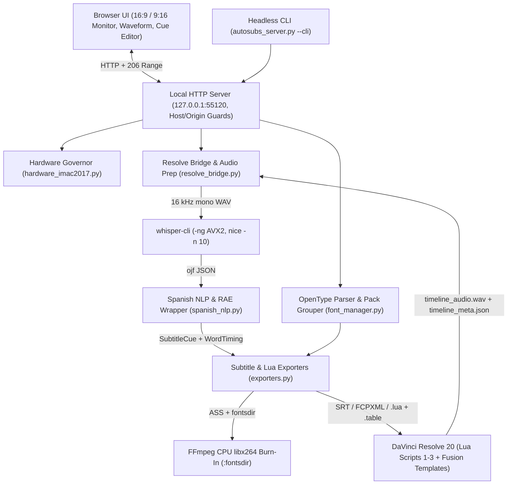

# Design document: MTTN AutoSubs Tool standalone studio and DaVinci Resolve 20 companion

This design document specifies the architecture, hardware resource controls, linguistic pipeline, animation engine, and security boundaries of MTTN AutoSubs Tool for engineers and technical video editors who maintain or extend the tool. It explains how the codebase delivers local Spanish AI subtitling, board-game terminology repair, and animated flipbook typography both as a standalone macOS application and as a DaVinci Resolve 20 companion on Intel and Apple Silicon hardware.

## Context and problem statement

Creators editing long-form Spanish video—especially board-game reviews and instructional content—need a workflow modeled after Tom Moroney's AutoSubs (`tmoroney/auto-subs`) that satisfies four constraints simultaneously:

1.  **Zero-cloud local transcription and editing**: Recordings ranging from 10 to 90 minutes (`500 MB` to `4 GB`) must run locally in both a standalone browser-backed desktop application (or headless CLI) and inside DaVinci Resolve 20 Free or Studio.
2.  **Legacy Intel iMac hardware limits**: The target workstation is a 2017 Retina 4K 21.5-inch iMac equipped with a `3 GHz Quad-Core Intel Core i5` processor (`x86_64` AVX2, 4 cores, 4 threads), `2 GB AMD Radeon Polaris` VRAM, `32 GB 2400 MHz DDR4` RAM, and `macOS 15.8.1`. Metal GPU offload triggers `GPU Memory Full` errors when DaVinci Resolve decodes 4K timelines, while Intel Python environments lack prebuilt `ctranslate2` wheels.
3.  **Spanish orthography and bilingual board-game jargon**: Whisper frequently omits opening Spanish punctuation (`¿`, `¡`), wraps lines across weak prepositions or articles, and mangles English board-game terms pronounced with Spanish phonetics (`mipels`, `dec bilding`, `eurogueim`, `setap`, `be ge ge`).
4.  **Multi-font flipbook animation across subtitle timelines**: Typefaces such as `Anitype Journal` ship five static variant files (`1` through `5`) meant to cycle every few frames. Native DaVinci Resolve subtitle tracks (`ST`) reject Fusion plugins and frame expressions, so animation must operate on video tracks or sliced XML titles without duplicating heavy shader passes across 2 GB VRAM.

## Goals and non-goals

### Goals

-   **Dual-mode operation with zero `pip` dependencies**: Run on stock macOS Python `3.10` or later plus Homebrew `whisper-cpp` (`whisper-cli`) and `ffmpeg`, serving either a standalone chromeless `--app-window` UI, a headless `--cli` pipeline, or a DaVinci Resolve 20 companion.
-   **High Spanish and anglicism accuracy within 32 GB RAM**: Default to `ggml-large-v3-turbo-q8_0.bin` (`1,550 MB` RAM) with optional `ggml-large-v3-q5_0.bin` (`2,100 MB` RAM), sustained initial prompt conditioning, deterministic phonetic repair, and Real Academia Española (RAE) line wrapping.
-   **Zero Whisper VRAM contention**: Enforce CPU AVX2 inference (`--no-gpu`) and CPU `libx264` MP4 subtitle burn-ins while reserving 1 CPU core when DaVinci Resolve is open.
-   **Resolve 20 Free and Studio compatibility**: Support one-shot Lua utility scripts for DaVinci Resolve 20 Free alongside direct Studio scripting when unlocked, with frame-accurate Non-Drop-Frame (NDF) timecodes across `23.976` and `29.97` fps timelines.
-   **Self-contained custom font animation**: Parse OpenType and TrueType `name` and `cmap` tables in pure Python, warn when display fonts lack accented Spanish characters, provide non-destructive ASCII glyph folding, and drive five-font flipbook animation through a single active Fusion branch or sliced `FCPXML 1.9` clips.

### Non-goals

-   **Multi-user network hosting or cloud SaaS deployment**: MTTN AutoSubs Tool binds strictly to `127.0.0.1` for a single local creator and excludes multi-tenant authentication or external storage backends.
-   **Native C++ OpenFX subtitle rendering across `ST` tracks**: DaVinci Resolve prohibits OpenFX and Fusion modifiers on `ST` tracks, so subtitle rendering targets native `ST` captions, Fusion `Text+` clips, `FCPXML 1.9` Basic Titles, or standalone MP4 outputs.
-   **Cross-platform Windows or Linux GUI packaging**: While the Python server and test suite run on Linux in CI, macOS `~/Applications/MTTN AutoSubs Tool.app`, `~/Library/Fonts`, and Resolve Fusion installers target `darwin`.

## System architecture and repository layout

MTTN AutoSubs Tool isolates transcription, hardware budgeting, Spanish linguistic normalization, subtitle serialization, font parsing, and DaVinci Resolve IPC into single-purpose Python modules orchestrated by the `autosubs_server.py` module.

All source, documentation, test, build, and macOS distribution assets live in one self-contained repository directory:

| Repository path | Role | Key contents |
| :--- | :--- | :--- |
| `autosubs_server.py` | Runtime orchestration | Threaded local HTTP server, CSRF origin guard, HTTP `206` chunked range streaming, background job tracking, `--app-window`, and `--cli` modes. |
| `hardware_imac2017.py` | Hardware profile and commands | `IMAC_2017_PROFILE`, `MODEL_CATALOG`, Homebrew binary lookup, `pgrep` Resolve detection, `--carry-initial-prompt` probing, and `whisper-cli` / `ffmpeg` command builders. |
| `spanish_nlp.py` | Spanish NLP and segmentation | Whisper `-ojf` parser, UTF-8 BPE byte recovery, hallucination filter, `DOMAIN_PROFILES` (`juegos_mesa`), `BOARDGAME_PHONETIC_FIXES`, inverted `¿`/`¡` repair, and RAE line wrapper. |
| `exporters.py` | Serialization engine | Uniform `render_export` router for `.srt`, `.srt_tc`, `.vtt`, `.ass`, `.txt`, `.txt_tc`, `.fcpxml`, and `.json`, plus `ms_to_timeline_tc_ms` NDF timecode conversion and Lua payload writers. |
| `resolve_bridge.py` | Resolve IPC and audio prep | `16 kHz` WAV extraction, chunked waveform peaks, Studio Python scripting integration, and file-mailbox sync with `Fusion.prefs` fallback. |
| `font_manager.py` | Typography and glyph checks | Binary OpenType/TrueType `name` and `cmap` (`0`, `4`, `6`, `12`) parser, Spanish accent checks, flipbook variant grouping, and ZIP-slip-safe font installation. |
| `package_bundle.py` | Distribution packager | Builds and verifies deterministic `MTTN_AutoSubs_Tool.zip` archives with POSIX execute bits and zero `__pycache__` residue. |
| `autosubs_es_test.py` | Automated test suite | Offline unit and HTTP integration tests using synthetic `whisper-cli`/`ffmpeg` stubs and real TCP loopback servers. |
| `ui/` | Studio web frontend | `index.html`, `styles.css`, and vanilla ES2022 `app.js` providing live karaoke preview, waveform scrubbing, inline cue editing, and font pack controls. |
| `lua/` | Resolve Utility scripts | `1_AutoSubs_ES_Exportar_Audio.lua`, `2_AutoSubs_ES_Insertar_Subtitulos.lua`, and `3_AutoSubs_ES_Ir_A_Tiempo.lua` (installed as `1 - MTTN AutoSubs - ...`) for Resolve 20 Free and Studio. |
| `templates/` | Fusion `Text+` macros | Five Retina 4K templates (`Cine_Netflix`, `Amarillo_Clasico`, `Reels_Impacto`, `Caja_Editorial`, and `Anitype_Animado`) installed under `Effects > Titles > MTTN AutoSubs`. |
| `install_imac.sh`, `Iniciar AutoSubs ES.command` | macOS installation and launch | Homebrew bootstrap, `MTTN AutoSubs Tool.app` generator, Resolve asset installer, and Finder launcher. |
| `BUILD`, `pyproject.toml`, `.gitignore` | Build and repo metadata | Blaze Python build/test/bundle rules, PEP 621 zero-dependency manifest, and clean local VCS exclusions. |
| `README.md`, `docs/` | Documentation suite | Gateway overview, three UI screenshots, `design-doc.md`, `user-guide.md`, `imac-2017-architecture.md`, `spanish-subtitling-reference.md`, and `troubleshooting.md`. |

## Key design decisions and alternatives considered

Each architectural boundary resolves a platform restriction imposed by Intel macOS, the 2 GB GPU, or DaVinci Resolve 20.

| Subsystem | Chosen design | Alternatives rejected | Rationale |
| :--- | :--- | :--- | :--- |
| Application host and UI | Python standard library `ThreadingHTTPServer` plus vanilla HTML, CSS, and ES2022 JS (`127.0.0.1:55120`) | Electron desktop wrapper; Tauri plus Rust WebView | Eliminates Node, Chromium, and Rust toolchains on macOS; launches fast in `--app-window` Chrome or Edge or standard browser tabs with zero `pip` installs. |
| Speech engine | Homebrew `whisper-cpp` (`whisper-cli`) running CPU AVX2 (`--no-gpu`) with `turbo-q8` and `large-v3-q5` | `faster-whisper` (`ctranslate2`); CoreML encoders; Metal GPU offload | `ctranslate2` drops prebuilt `x86_64` macOS wheels; Core i5 lacks an Apple Neural Engine; Metal offload triggers `GPU Memory Full` errors alongside Resolve 4K timelines. |
| Resolve 20 integration | Hybrid Studio API plus one-shot Lua scripts exchanging `.lua`, `.table`, and `Fusion.prefs` payloads | Resident background Lua polling loop; Studio-only external Python daemon | Resolve 20 Free blocks external Python scripting and `UIManager` UIs, while resident `fusion:Execute` loops freeze the Resolve timeline thread. |
| Animated flipbook fonts | Single-node-branch `AutoSubs_ES_Anitype_Animado` Fusion macro plus sliced `FCPXML 1.9` Basic Titles | OpenFX plugin on native `ST` subtitle track; Video Adjustment Clip effects | Resolve `ST` tracks disallow Fusion effects and frame expressions; Adjustment Clips sit underneath `ST` tracks and waste 4K Polaris VRAM re-filtering underlying video. |
| Domain and Spanish cleanup | Persistent `--carry-initial-prompt -mc 64` conditioning plus deterministic `BOARDGAME_PHONETIC_FIXES` and RAE scoring | Prompt-only conditioning; custom fine-tuned Whisper checkpoints | Prompts alone still yield literal phonetic spellings (`mipels`, `dec bilding`) and rarely insert `¿`/`¡`, while deterministic rules repair errors reversibly without re-running Whisper. |

### Why flipbook animation belongs inside AutoSubs ES rather than a standalone track plugin

Users often ask whether a standalone plugin could animate an entire DaVinci Resolve subtitle track (`ST`) after subtitling. Native `ST` tracks in Resolve expose track-level text attributes only; they reject Fusion macro modifiers, OpenFX plugins, and frame expressions. Placing an effect onto an Adjustment Clip on a higher `V` track also misses `ST` captions because `ST` renders above every `V` track, and applying distortion shaders across full 4K frames exhausts 2 GB VRAM.

Integrating flipbook timing directly inside AutoSubs ES solves both constraints. For Fusion workflows, `AutoSubs_ES_Anitype_Animado.setting` switches across five `TextPlus` nodes through `floor()` modular `Dissolve` expressions (`VariantSel2`–`VariantSel5`) and one `BoilTransform` node; Fusion evaluates only the branch with weight `1`, matching single-node `Text+` GPU cost. For workflows without Media Pool templates, the `exporters.py` module slices `FCPXML 1.9` Basic Titles directly at frame holds (`anim_hold_frames`).

## Core subsystem specifications

### Hardware governor and child process lifecycle

The `hardware_imac2017.py` module adapts runtime scheduling dynamically based on whether DaVinci Resolve is open:

-   **Thread allocation**: When `is_resolve_running` detects a Resolve process through `pgrep -x`, AutoSubs ES schedules `3` threads with `nice -n 10`, preserving 1 physical Intel Core i5 core for UI scrubbing and macOS WindowServer; in standalone mode, Whisper and `libx264` burn-ins use all `4` physical threads.
-   **Persistent prompt detection**: The `whisper_supports_flag` helper inspects `whisper-cli --help` output and appends `--carry-initial-prompt` together with `-mc 64` when supported, carrying the 580-character Spanish dialect and board-game vocabulary prompt past the first 30-second window.
-   **POSIX process-group reaping**: Both Whisper transcription and `ffmpeg` burn-in workers spawn inside dedicated sessions (`start_new_session=True` on POSIX). Canceling a job calls the `_terminate_process` helper, which signals the whole `nice` and child binary process group with `SIGTERM`, polls up to `1.0s` in a daemon thread, and sends `SIGKILL` to prevent orphaned CPU-bound processes.
-   **Workspace hygiene**: Transcription swaps per-job `working_<job_id>_16k.wav` audio files and removes prior working WAVs, intermediate `.json` outputs, `.ass` burn-in scripts, and `--cli` temporary WAVs inside `finally` cleanup blocks.

### Spanish NLP, phonetic repair, and RAE wrapping

The `spanish_nlp.py` module processes raw `-ojf` token streams into formatted `SubtitleCue` objects:

1.  **Hallucination suppression**: The `is_spanish_hallucination` filter removes known Spanish Whisper silence hallucinations (such as `amara.org` and `Suscríbete al canal`) plus low-confidence token repetition loops.
2.  **BPE split-byte recovery**: When `-sow` splits accented UTF-8 characters into `\ufffd` tokens, `parse_whisper_ojf` aligns clean segment words across the segment time span instead of emitting corrupt glyphs.
3.  **Board-game phonetic repair and glossary precedence**: Under `domain = "juegos_mesa"`, `clean_spanish_words` normalizes Spanish phonetic misspellings (~70 `BOARDGAME_PHONETIC_FIXES` rules covering `eurogame`, `meeples`, `deckbuilding`, `worker placement`, `playmat`, `Kickstarter`, and `BGG`) even when wrapped in curly quotes (`“ ” ‘ ’`) or Spanish dialogue dashes (`—`, `–`), then restores exact multi-word and single-word casing from `custom_glossary`.
4.  **Hesitation-aware inverted punctuation**: `_repair_inverted_spanish_punctuation` scans `?` and `!` clauses past leading discourse markers (`Oye,`, `Mira,`, `Vale,`) and hesitations (`eh`, `em`, `mm`) before inserting `¿` or `¡`, and tracks edited cue token mismatches in `SubtitleCue.from_dict` by dropping stale per-word timings so karaoke never drifts after manual text edits.
5.  **RAE penalty line wrapping**: `wrap_spanish_lines` scores every split between two lines, penalizing character overflow (`+500.0` per excess character), weak stranded endings (`SPANISH_WEAK_LINE_ENDINGS`: `+120.0`), and split `¿`/`¡` openers (`+70.0`), while rewarding punctuation boundaries and bottom-heavy pyramid geometry.

### Timecode precision, exporters, and Resolve IPC

Two precision hazards affect DaVinci Resolve timelines on macOS and are handled directly in the `exporters.py` and `resolve_bridge.py` modules:

-   **Eliminating `+3.6 s/hour` NDF drift on `23.976` and `29.97` fps**: Real audio elapsed milliseconds run at `1000/1001` slower clock rate than integer NDF SMPTE counters (`24`, `30`, or `60`). Both `ms_to_timeline_tc_ms` (backing `export_srt_timeline_tc`) and `frames_to_smpte` (backing `jump_playhead` and Resolve Lua payloads) apply `effective_fps` rational rates (`24000/1001`, `30000/1001`, `60000/1001`), keeping a 1,001-second clip aligned at exact timeline timecode `01:16:40:00`.
-   **Unified export routing and ASS injection hardening**: All HTTP downloads (`POST /api/export`) and CLI outputs share the `exporters.render_export` router across eight formats (`srt`, `srt_tc`, `vtt`, `ass`, `txt`, `txt_tc`, `fcpxml`, `json`). ASS karaoke strips commas and newlines from font and speaker headers (`_sanitize_ass_field`), escapes literal braces (`\{`, `\}`) using `_escape_ass_text`, falls back to plain line text when `len(cue.words)` disagrees with edited lines, and passes `:fontsdir` to `ffmpeg` so uploaded `.otf` or `.ttf` fonts render during MP4 burn-ins before macOS restarts font caches.
-   **Resilient Lua IPC**: `resolve_bridge.py` writes both `push_payload.lua` (`return { ... }`) and `push_payload.table` (`{ ... }`), because DaVinci Resolve's `bmd.readfile` rejects `return` statements. Script 2 verifies both `#appended > 0` and track item growth (`GetItemListInTrack`) so silent empty-table returns never report false success.

### OpenType parsing and non-destructive ASCII folding

Because third-party display fonts such as `Anitype Journal` omit Spanish diacritics and Fusion leaves missing glyphs blank, the `font_manager.py` module implements pure-stdlib SFNT parsing (`name` table plus `cmap` formats `0`, `4`, `6`, and `12`) to detect missing characters in `áéíóúüñÁÉÍÓÚÜÑ¿¡`. When gaps appear, enabling **Adaptar glifos ASCII** (`StyleConfig.ascii_fold`) keeps accented Spanish spelling intact inside the editor state and JSON outputs while applying `fold_spanish_to_ascii` solely during export rendering.

## Security, streaming, and operational shortcuts

AutoSubs ES exposes an unauthenticated local control plane to your browser, so all security defenses operate at the HTTP request boundary and filesystem boundary:

-   **Localhost DNS-rebinding and CSRF defense**: Every request passes `_check_request_origin(mutating)`. Any `Host` header outside `127.0.0.1`, `localhost`, or `[::1]` is rejected immediately. Every mutating request (`POST` or `PUT`) additionally rejects cross-site browser requests (`Sec-Fetch-Site: cross-site`) and verifies any `Origin` header (including `Origin: null` from sandboxed pages) against localhost, returning a `403 Forbidden` HTTP status code.
-   **Filesystem confinement**: Uploaded filenames pass basename sanitization (`_safe_filename`), font ZIP archives reject `..`, `__MACOSX`, and dot-segments above a `64 MB` uncompressed cap (`MAX_UPLOAD_BYTES`), and `start_transcription` enforces `Path.is_relative_to(self.app_dir.resolve())` on any `media_path` override (while the UI omits client-supplied paths).
-   **Bounded-memory HTTP `206` range streaming**: `/api/media`, `/api/exported-video`, and `/api/fonts/file/...` stream files through `_stream_file` in `131072`-byte chunks with proper `206 Partial Content` and `416 Range Not Satisfiable` responses instead of buffering entire MP4 renders in memory.
-   **Stale session isolation**: Uploading a local video or detecting a changed Resolve inbox WAV hash bumps `media_rev` and clears prior cues and word timings cleanly.

Two intentional engineering shortcuts keep operational complexity minimal and carry explicit code comments (`# shortcut:`):

-   **In-memory job retention (`_MAX_RETAINED_JOBS = 100`)**: `AppState.jobs` prunes completed jobs past `100` entries in RAM instead of maintaining a SQLite database; multi-project server history would swap in SQLite.
-   **Animated FCPXML slice ceiling (`_MAX_ANIMATED_FCPXML_SLICES = 2500`)**: `export_fcpxml` caps frame-hold title slicing at `2,500` clips (roughly 5 minutes at `hold=3` frames on a 24 fps timeline) to avoid Resolve XML stalls; longer animated timelines should use the single-node `AutoSubs_ES_Anitype_Animado` Fusion template instead.

## Verification strategy

Automated offline verification runs via `python3 -B autosubs_es_test.py -v` in local checkouts and GitHub Actions CI without external `whisper-cli`, `ffmpeg`, or Resolve binaries:

| Test suite | Verified behavior |
| :--- | :--- |
| `HardwareIMac2017Test` | iMac 2017 Core i5 and 2 GB Polaris profile, `-ng` enforcement, GGML model discovery, `--carry-initial-prompt` capability probe, and `:fontsdir` burn-in command escaping. |
| `SpanishNlpTest` | Whisper `-ojf` BPE UTF-8 recovery, silence-hallucination filtering, RAE weak-ending avoidance, non-overlapping cues, `juegos_mesa` anglicisms, curly quotes, dialogue dashes, and hesitation-aware `¿`/`¡`. |
| `ExportersTest` | `.srt`, `.srt_tc`, `.vtt`, `.ass`, `.txt`, `.fcpxml`, Lua `.table` payloads, exact `23.976` fps NDF alignment (`01:16:40,000` at `1,001s`), edited cue word resets, and `{}` / `,` ASS escaping. |
| `FontManagerAndAnitypeTest` | Binary `.otf`/`.ttf`/`.zip` parsing, Spanish glyph warnings, five-variant pack grouping, `~/Library/Fonts` copy, and non-destructive ASCII folding. |
| `BridgeAndServerIntegrationTest` | Live TCP HTTP workflow (`demo`, `cues`, `resegment`, `export`, `resolve/push`), `Host`/`Origin`/`media_path` `403`/`400` guards, HTTP `206` MP4 byte-range streaming, upload state resets, and `--cli` cleanup. |
| `ResolveTemplatesAndBundleTest` | Presence of `UseFrameFormatSettings = 1` across all five `.setting` macros, zero `math.`/`%` errors in Fusion expressions, three-tier Lua loading, and `verify_zip_bytes` bundle validation. |

Physical macOS execution with real downloaded GGML weights, Homebrew `whisper-cli`/`ffmpeg`, and DaVinci Resolve 20 Media Pool rendering must still be exercised directly on the target 2017 iMac hardware.

## What's next

-   Follow daily editing workflows in the [user guide](user-guide.md).
-   Inspect Whisper model sizing, Fusion IPC details, and HTTP schemas in the [architecture and 2017 iMac tuning guide](imac-2017-architecture.md).
-   Configure RAE line-wrapping presets and board-game glossaries in the [Spanish subtitling reference](spanish-subtitling-reference.md).
-   Diagnose macOS Gatekeeper, font cache, or Resolve Media Pool setup issues in the [troubleshooting guide](troubleshooting.md).
