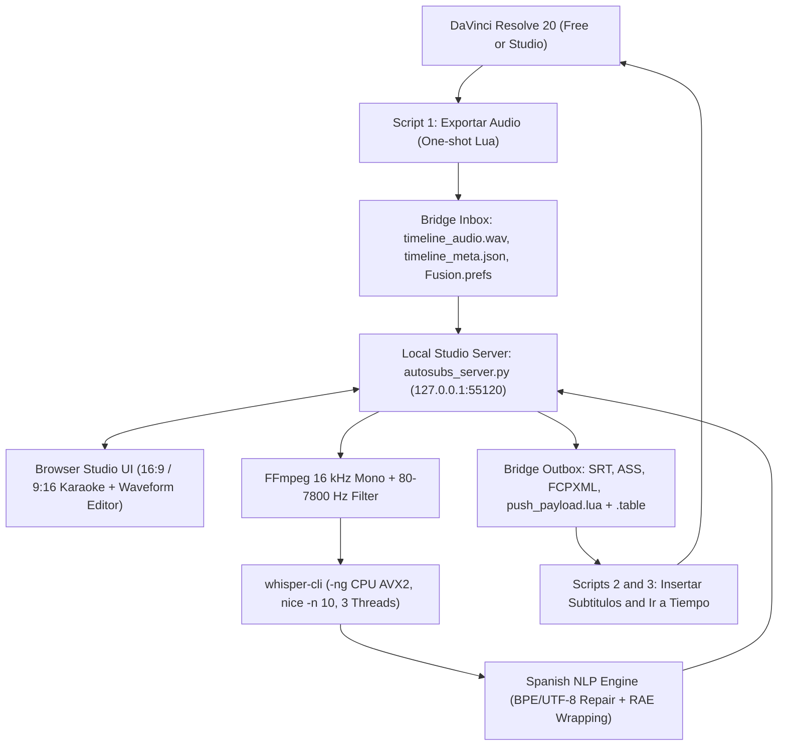

<!-- go/g3mark-in-g3doc -->

# Architecture and 2017 Retina 4K iMac hardware tuning

This architecture reference helps developers and technical video editors understand how AutoSubs ES schedules CPU, RAM, GPU VRAM, and DaVinci Resolve 20 IPC across Intel macOS workstations and DaVinci Resolve Free or Studio.

## System architecture

AutoSubs ES runs as a zero-dependency Python standard library HTTP server (`autosubs_server.py`) that coordinates `ffmpeg` audio normalization, `whisper-cli` (`whisper-cpp`) CPU transcription, Spanish RAE formatting (`spanish_nlp.py`), subtitle serialization (`exporters.py`), and a non-blocking DaVinci Resolve 20 bridge (`resolve_bridge.py`).

Each Python module owns a focused stage of the pipeline with no external pip dependencies:

| Module | Primary responsibility |
| :--- | :--- |
| `hardware_imac2017.py` | Detects Homebrew Intel or Apple Silicon paths, inspects installed GGML models, monitors Resolve processes with `pgrep`, detects `--carry-initial-prompt` flag support (`whisper_supports_flag`), and builds `nice -n 10` `whisper-cli -ng` commands plus CPU `libx264` burn-in commands (`build_ffmpeg_burnin_command`). |
| `resolve_bridge.py` | Extracts 16 kHz mono WAV audio, computes chunked waveform peaks, connects to Resolve Studio scripting when unlocked, and manages `bridge/inbox` and `bridge/outbox` plus `Fusion.prefs` fallback. |
| `spanish_nlp.py` | Parses `whisper-cli -ojf` JSON, repairs split multi-byte UTF-8 tokens, filters Spanish hallucinations, applies `DOMAIN_PROFILES` (`juegos_mesa` board-game terms and ~70 `BOARDGAME_PHONETIC_FIXES` anglicism repairs), applies custom glossaries and hesitation-aware inverted `¿` / `¡` punctuation, and wraps lines by using RAE weak-word avoidance. |
| `exporters.py` | Serializes cues to SubRip `.srt`, NDF timeline `.srt_tc` (`export_srt_timeline_tc`), WebVTT `.vtt`, `.ass` word-level `\kf` karaoke, FCPXML 1.9 Basic Titles (including multi-font flipbook frame slicing), clean or timestamped `.txt` transcripts (`export_txt`), and sandbox-safe Lua payloads (`push_payload.lua` and `push_payload.table`), with non-destructive Spanish ASCII folding (`fold_spanish_to_ascii`). |
| `font_manager.py` | Parses OpenType and TrueType `name` and `cmap` tables using Python standard library modules, audits Spanish glyph coverage (`áéíóúüñÁÉÍÓÚÜÑ¿¡`), groups numbered flipbook variants into packs, syncs uploaded `.otf`/`.ttf`/`.ttc`/`.zip` files to `~/Library/Fonts`, and serves browser `@font-face` binaries. |
| `autosubs_server.py` | Serves static UI assets and uploaded fonts, enforces `Host`/`Origin` localhost CSRF guards, streams `/api/media` and `/api/exported-video` with chunked HTTP `206` byte-range support, receives raw binary media and font uploads, runs chromeless `--app-window` UI or headless `--cli` batch transcription, tracks background jobs (including `/api/export-video` CPU MP4 burn-in), and exposes REST endpoints. |
| `package_bundle.py` | Assembles a deterministic, permission-preserving `AutoSubs_ES.zip` distribution archive with built-in structural validation. |

## Design decisions and hardware trade-offs

Every subsystem reflects hardware measurements from a **2017 Retina 4K 21.5-inch iMac** configured with a `3 GHz Quad-Core Intel Core i5` (`x86_64`, 4 physical cores, 4 threads, AVX2, no Apple Neural Engine), `32 GB 2400 MHz DDR4` RAM, `AMD Radeon Polaris 2 GB` VRAM, and `macOS 15.8.1`.

### Native `whisper-cpp` over `faster-whisper` or CoreML

-   **Intel macOS wheel availability**: Recent releases of `ctranslate2` and `faster-whisper` omit prebuilt `macosx_x86_64` wheels, requiring fragile local C++ builds. Homebrew `whisper-cpp` ships compiled `x86_64` AVX2 binaries that install cleanly.
-   **No Apple Neural Engine on Intel**: Intel Core i5 CPUs lack Apple Neural Engine hardware, so CoreML encoders fall back to CPU or Metal shaders anyway. Native `whisper-cli` AVX2 execution stays predictable across macOS versions.

### Protecting the 2 GB AMD Radeon Polaris GPU (`--no-gpu`)

-   **Preventing Resolve VRAM saturation**: DaVinci Resolve 20 uses nearly all 2 GB of Polaris VRAM when decoding 4K H.264/HEVC timelines. Loading Whisper weights into Metal GPU memory triggers `GPU Memory Full` errors in Resolve and destabilizes macOS 15.8.1 OpenCore Legacy Patcher Polaris Metal compute drivers.
-   **Zero-VRAM policy**: Passing `-ng` (`--no-gpu`) forces `whisper-cli` to run exclusively on CPU AVX2 instructions and your 32 GB DDR4 memory pool.

### Balancing the 4-core Core i5 and 32 GB DDR4 pool

-   **Thread governor**: `IMAC_2017_PROFILE` detects running Resolve processes by using the `pgrep -x` command and caps `whisper-cli` at `3` threads with `nice -n 10` (`4` threads when Resolve is closed in standalone mode), reserving one physical core for macOS WindowServer and Resolve timeline scrubbing.
-   **Model architecture for 32 GB RAM**: With 32 GB of DDR4 memory available, AutoSubs ES defaults to `ggml-large-v3-turbo-q8_0.bin` (~1.55 GB RAM, 4 decoder layers) for near-lossless 8-bit Turbo transcription, and includes full 32-layer `ggml-large-v3-q5_0.bin` (~2.1 GB RAM) for maximum Spanish and bilingual anglicism fidelity.
-   **Persistent prompt conditioning**: `build_whisper_command` probes `whisper-cli --help` through `whisper_supports_flag` and adds `--carry-initial-prompt` together with `-mc 64` when supported so Spanish punctuation and board-game vocabulary priming persist past the initial 30-second window.
-   **CPU MP4 burn-in**: `build_ffmpeg_burnin_command` encodes burned-in `.mp4` videos with `libx264` (`-preset veryfast`, `-crf 19`, `-threads 3` or `4`, `-pix_fmt yuv420p`) and the `ass=` filter instead of Apple VideoToolbox hardware encoders that share memory pressure with the 2 GB Polaris card.

### DaVinci Resolve 20 Free versus Studio IPC

DaVinci Resolve 20 Free blocks external Python scripting connections and `Fusion()` `UIManager` GUI windows, and resident polling loops inside `fusion:Execute` freeze Resolve's main UI thread. AutoSubs ES avoids both pitfalls:

1.  **One-shot Utility scripts**: **Script 1**, **Script 2**, and **Script 3** execute once from **Workspace** > **Scripts**, perform their API calls, print status to the Resolve Console, and exit immediately.
2.  **Three-tier Lua payload loading**: `loadLuaModule` tries `loadfile(path)`, then `io.open(path, "r")` with `load` or `loadstring`, and finally `bmd.readfile(path)` against a pure `{ ... }` `.table` companion file generated by `resolve_bridge.py` (`bmd.readfile` parses raw table literals and returns `nil` on `return { ... }` modules).
3.  **Strict empty-table verification**: When `mediaPool:AppendToTimeline(...)` fails to drop an `.srt` file onto a subtitle track in Resolve, the API returns `{}` (which is truthy in Lua). Script 2 checks both `#appended > 0` and `#timeline:GetItemListInTrack("subtitle", subCount) > 0` before reporting success.
4.  **Retina 4K and flipbook Fusion `Text+` templates**: All five templates under `templates/` set `UseFrameFormatSettings = Input { Value = 1, }` inside every `TextPlus` node for native 3840x2160 vector edges without multi-node Glow or Blur chains. Four static presets use one `TextPlus` node, while `AutoSubs_ES_Anitype_Animado.setting` exposes `HoldFrames`, `VariantCount`, and `BoilJitter` macro controls over five `TextPlus` inputs switched through pure `floor()` modular `Mix` expressions (`0` or `1`) across four `Dissolve` selectors (`VariantSel2`–`VariantSel5`) plus a stepped `BoilTransform` node. Because Fusion `Dissolve` evaluates only branches with non-zero weight (`0` skips upstream rasterization), GPU load matches a single active `TextPlus` branch per frame on the 2 GB Polaris card. Putting a plugin across a native `ST` subtitle track fails in Resolve because `ST` rejects Fusion effects and expressions, while Video Adjustment Clips render below `ST` and touch underlying 4K video footage.

## Whisper model catalog

The following GGML models are defined in `hardware_imac2017.py` and download directly from Hugging Face into your local `models/` directory:

| Model ID | Filename | Download size | Peak RAM | Approximate Spanish WER | Hardware role |
| :--- | :--- | :--- | :--- | :--- | :--- |
| `turbo-q8` | `ggml-large-v3-turbo-q8_0.bin` | 834 MB | 1,550 MB | 2.1% | Default recommended 8-bit near-lossless model for 32 GB RAM and 4-core i5 speed. |
| `large-v3-q5` | `ggml-large-v3-q5_0.bin` | 1,080 MB | 2,100 MB | 1.9% | Full 32-layer Q5_0 model for maximum Spanish and anglicism accuracy across noisy or technical dialogue. |
| `turbo-q5` | `ggml-large-v3-turbo-q5_0.bin` | 547 MB | 1,100 MB | 2.3% | Balanced 5-bit Turbo option for faster throughput on longer episodes. |
| `small-q8` | `ggml-small-q8_0.bin` | 252 MB | 650 MB | 5.2% | Fast rough-cut drafts on 3 or 4 CPU threads with clean dialogue. |
| `base-q8` | `ggml-base-q8_0.bin` | 82 MB | 320 MB | 8.2% | Lightweight pipeline validation when bandwidth is constrained. |

## Configuration variables and local HTTP API

Set any of these environment variables before starting `autosubs_server.py` to override default macOS directories:

-   `AUTOSUBS_ES_HOME`: Overrides `~/Library/Application Support/AutoSubsES` for model storage, custom font storage, audio cache, and bridge mailboxes.
-   `AUTOSUBS_RESOLVE_FUSION_DIR`: Overrides `~/Library/Application Support/Blackmagic Design/DaVinci Resolve/Fusion` when testing custom Fusion script or `Fusion.prefs` locations.
-   `AUTOSUBS_USER_FONTS_DIR`: Overrides `~/Library/Fonts` when syncing uploaded fonts on macOS or running isolated integration tests.

`AutoSubsHandler` exposes the following local HTTP endpoints on `127.0.0.1`:

| Method | Route | Request or response role |
| :--- | :--- | :--- |
| `GET` | `/` | Serves `ui/index.html` (also serves `/styles.css` and `/app.js`). |
| `GET` | `/api/status` | Returns hardware profile, installed models, Resolve bridge status, presets, dialects, font catalog, and session snapshot. |
| `GET` | `/api/fonts` | Returns built-in fonts, custom uploaded or macOS faces, Spanish `cmap` coverage warnings, and grouped animated packs. |
| `GET` | `/api/fonts/file/FONT_ID` | Serves `.otf`, `.ttf`, or `.ttc` font files with `font/otf` or `font/ttf` media types for browser `@font-face` previews. |
| `GET` | `/api/media` | Streams active `.wav` or uploaded `.mp4`, `.mov`, or `.mkv` video with HTTP `206 Partial Content` `Range` seeking support. |
| `GET` | `/api/exported-video` | Streams or downloads the latest rendered `.mp4` burned-in video with HTTP `206` range support. |
| `GET` | `/api/jobs/JOB_ID` | Returns background download, Whisper transcription, or MP4 burn-in progress percentage and stage message. |
| `POST` | `/api/upload` | Streams raw media uploads into `cache/` by using the `X-Filename` header (avoids the Python 3.13 removed `cgi` module). |
| `POST` | `/api/fonts/upload` | Parses `.otf`, `.ttf`, `.ttc`, or `.zip` font uploads (up to 64 MB), checks Spanish glyph support, groups flipbook packs, and optionally copies files to `~/Library/Fonts`. |
| `POST` | `/api/models/download` | Starts a resumable Hugging Face GGML download job (`model_id`). |
| `POST` | `/api/transcribe` | Converts source audio to 16 kHz mono WAV and executes `whisper-cli -ng -ojf -sow` (with `--carry-initial-prompt -mc 64` when supported) in a worker thread. |
| `POST` | `/api/jobs/JOB_ID/cancel` | Terminates a running download, `whisper-cli`, or FFmpeg burn-in subprocess cleanly. |
| `POST` | `/api/demo` | Loads built-in Spanish board-game and Resolve demo cues and synthesizes a local 16 kHz waveform WAV. |
| `POST` | `/api/resegment` | Re-applies RAE wrapping, domain phonetic fixes, dialects, muletilla cleanup, and punctuation rules in memory without re-running Whisper. |
| `POST` | `/api/export` | Serializes active cues into `srt`, `srt_tc`, `vtt`, `ass`, `txt`, `txt_tc`, `fcpxml`, or `json`. |
| `POST` | `/api/export-video` | Starts a CPU `libx264` background job burning styled `.ass` subtitles into the active standalone video file. |
| `POST` | `/api/resolve/export-audio` | Triggers Deliver WAV export directly through Resolve Studio scripting or guides Resolve Free users to Script 1. |
| `POST` | `/api/resolve/notify-export` | Refreshes inbox metadata and waveform peaks when Script 1 completes its audio bounce. |
| `POST` | `/api/resolve/push` | Writes `outbox/` artifacts (`.srt`, `.ass`, `.fcpxml`, `.lua`, and `.table`) and pushes directly in Studio. |
| `POST` | `/api/resolve/jump` | Jumps the Resolve Studio playhead directly or stages `jump_tc.lua` and `jump_tc.table` for Script 3. |
| `PUT` | `/api/cues` | Commits manual cue text and timing edits while enforcing monotonic non-overlapping timestamps. |

## What's next

-   Read full design choices, security boundaries, and rejected alternatives in the [engineering design document](design-doc.md).
-   Follow step-by-step operating instructions in the [user guide](user-guide.md).
-   Inspect Spanish linguistic heuristics and exact preset constants in the [Spanish subtitling reference](spanish-subtitling-reference.md).
-   Diagnose macOS or Resolve workflow issues in the [troubleshooting guide](troubleshooting.md).
