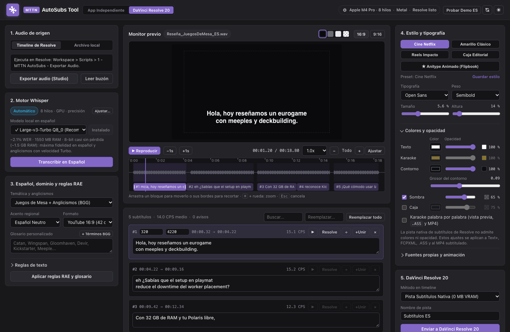
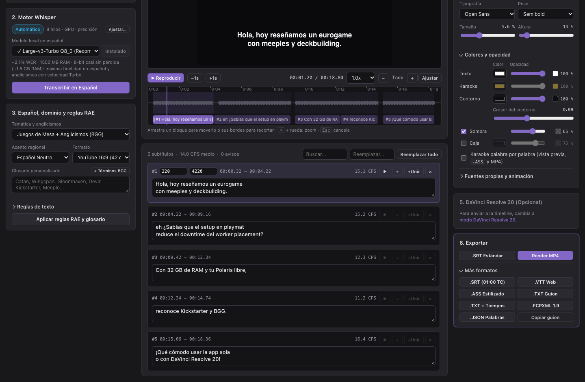
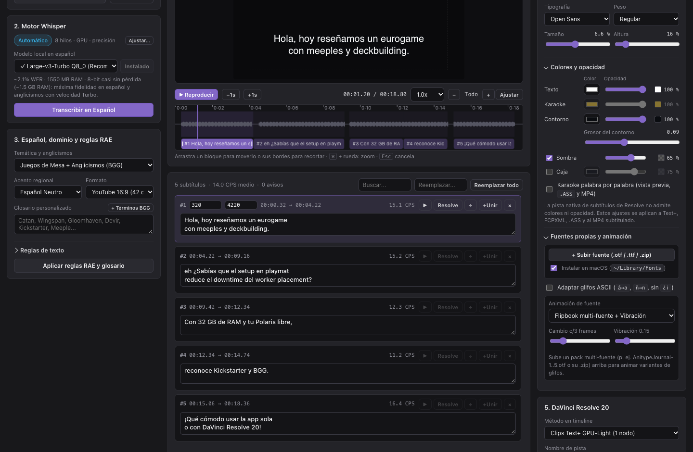

<!-- go/g3mark-in-g3doc -->

# User guide for AutoSubs ES on macOS and DaVinci Resolve 20

This guide helps Spanish-language creators install, configure, and operate AutoSubs ES either as a standalone macOS application and CLI tool or alongside DaVinci Resolve 20 Free or DaVinci Resolve 20 Studio. By following these workflows, you generate time-coded Spanish subtitles locally on Intel `x86_64` or Apple Silicon Macs without sending media to external servers or overloading limited GPU video memory.

AutoSubs ES runs locally on your Mac and incurs no cloud API or billing charges.

## Before you begin

Gather the following software and disk resources before installing AutoSubs ES:

-   **Operating system**: macOS 13 or later (tested on macOS 15.8.1 on Intel `x86_64` and compatible with Apple Silicon).
-   **Video editor (optional)**: DaVinci Resolve 20 Free or DaVinci Resolve 20 Studio for timeline audio extraction and `Text+` or `ST` subtitle push.
-   **Python runtime**: Python 3.10 or later.
-   **Package manager**: Homebrew installed at `/usr/local/bin/brew` (Intel Macs) or `/opt/homebrew/bin/brew` (Apple Silicon Macs).
-   **Free disk space**: Roughly 1.5 GB for the `whisper-cpp` binary, `ffmpeg`, and the `ggml-large-v3-turbo-q8_0.bin` Spanish model file (or 1.8 GB for `ggml-large-v3-q5_0.bin`).

## Install AutoSubs ES on macOS

The `install_imac.sh` script installs the `whisper-cpp` and `ffmpeg` packages through Homebrew, creates the standalone `~/Applications/AutoSubs ES.app` application bundle, copies the three DaVinci Resolve Lua bridge scripts, installs five Retina 4K Fusion `Text+` templates, and downloads the recommended Spanish Whisper model.

1.  Extract the `AutoSubs_ES.zip` archive into a permanent folder on your Mac.

2.  Open **Terminal** and change to the extracted directory:

    ```bash
    cd AUTOSUBS_DIR
    ```

    Replace the following:

    -   `AUTOSUBS_DIR`: the directory path that contains the extracted AutoSubs ES files.

3.  Run the macOS installer script:

    ```bash
    ./install_imac.sh
    ```

    Optional: Pass `--model=large-v3-q5` for maximum 32-layer Spanish accuracy, or pass `--skip-model` to download a different quantization later from the browser interface:

    ```bash
    ./install_imac.sh --model=large-v3-q5
    ```

4.  Restart DaVinci Resolve 20 if the application is open so the **Workspace** > **Scripts** menu and the **Effects** > **Titles** library load the added files.

The installer places runtime assets, the standalone app bundle, and Resolve extensions in the following standard macOS directories:

| Asset group | macOS destination path | Purpose |
| :--- | :--- | :--- |
| Standalone macOS app | `~/Applications/AutoSubs ES.app` | Launches AutoSubs ES in a dedicated chromeless Chrome or Edge window (`--app-window`) or browser tab without opening Terminal manually. |
| Whisper models and cache | `~/Library/Application Support/AutoSubsES/` | Stores `.bin` GGML models, temporary 16 kHz mono WAV audio, burned-in MP4 renders, and the `bridge/inbox` and `bridge/outbox` directories. |
| Resolve Lua scripts | `~/Library/Application Support/Blackmagic Design/DaVinci Resolve/Fusion/Scripts/Utility/` | Registers the three **AutoSubs ES** actions under **Workspace** &gt; **Scripts**. |
| Fusion `Text+` presets | `~/Library/Application Support/Blackmagic Design/DaVinci Resolve/Fusion/Templates/Edit/Titles/AutoSubs ES/` | Adds five `UseFrameFormatSettings = 1` title templates for Retina 4K, vertical, and animated flipbook timelines. |



## Start the local studio or run the headless CLI

Launch AutoSubs ES from Applications, Finder, or Terminal before starting your editing session:

-   In **Spotlight** or **Finder**, open `~/Applications/AutoSubs ES.app` or double-click `Iniciar AutoSubs ES.command`. Both launch Chrome or Edge in a chromeless standalone window when installed, or fall back to your default browser at `http://127.0.0.1:55120`.
-   In **Terminal**, change to your AutoSubs ES folder and start the Python server with `--app-window`:

    ```bash
    python3 -B autosubs_server.py --app-window
    ```

To use an alternate port or suppress automatic browser opening, add CLI flags to the command:

```bash
python3 -B autosubs_server.py \
  --host 127.0.0.1 \
  --port PORT_NUMBER \
  --no-browser
```

Replace the following:

-   `PORT_NUMBER`: an available local TCP port number such as `55121`.

To transcribe local audio or video files directly from Terminal without starting the web UI, pass the `--cli` flag:

```bash
python3 -B autosubs_server.py \
  --cli INPUT_MEDIA \
  --model turbo-q8 \
  --domain juegos_mesa \
  --output-srt OUTPUT_SRT
```

Replace the following:

-   `INPUT_MEDIA`: the audio or video file to transcribe.
-   `OUTPUT_SRT`: the output path for the formatted Spanish `.srt` file.

To test the waveform scrubber, karaoke monitor, RAE line-wrapping rules, board-game glossary cleanup, and Resolve export pipeline without running Whisper first, click **Probar Demo ES** in the top bar.

## Choose App Independiente or DaVinci Resolve 20 mode

Use the switcher next to the **AutoSubs ES** title in the top bar:

-   **App Independiente**: Highlights local media drag-and-drop with in-page HTML5 `<video>` and `<audio>` playback, uses all four Core i5 threads automatically when Resolve is closed, and makes **Render MP4** the primary action in **6. Exportar**, folds **5. DaVinci Resolve 20** to its title, (including plain-text transcripts and CPU `libx264` burned-in `.mp4` renders).
-   **DaVinci Resolve 20**: Shows the Resolve audio bounce controls first, keeps `3` threads reserved when Resolve is open, and brings **5. DaVinci Resolve 20** into focus for direct timeline insertion.



## Export timeline audio or load local media

You can feed audio into AutoSubs ES directly from a local media file or from an active DaVinci Resolve 20 timeline.

### Upload a local media file

1.  In the top bar, click **App Independiente**, or open the **Archivo local** tab inside **1. Audio de origen**.
2.  Drag a `.wav`, `.mp3`, `.m4a`, `.mp4`, `.mov`, or `.mkv` file onto the upload dropzone, or click the dropzone to select a file from disk.

Video files render directly in **Monitor previo** with frame-accurate synchronized subtitles.

### Export audio in DaVinci Resolve 20 Free or Studio

1.  Open your project and target timeline in DaVinci Resolve 20.
2.  In the Resolve menu bar, click **Workspace** > **Scripts** > **1 - AutoSubs ES - Exportar Audio**.
3.  Wait until the DaVinci Resolve **Console** prints that the `timeline_audio.wav` bounce finished.
4.  Return to AutoSubs ES and click **Leer buzón** if **Monitor previo** does not refresh automatically.

### Export audio directly in DaVinci Resolve 20 Studio

1.  Open your project and active timeline in DaVinci Resolve 20 Studio.
2.  In the **1. Audio de origen** card, open the **DaVinci Resolve 20** tab and click **Exportar audio (Studio)**.
3.  Wait for Resolve to finish bouncing the timeline mix into the inbox directory, then click **Leer buzón** if **Monitor previo** does not refresh automatically.

## Transcribe, edit, and style Spanish subtitles

Configure CPU scheduling, Whisper model precision, board-game terminology, and Spanish linguistic rules before running transcription, then refine cues inside the studio editor.

1.  In **2. Motor Whisper**, select your model from **Modelo local en español**. On a 32 GB RAM 2017 iMac, choose **Large-v3-Turbo Q8_0 (Recomendado 32 GB)** (`ggml-large-v3-turbo-q8_0.bin`) as your everyday default, or **Large-v3 Completo Q5_0 (Máxima precisión ES)** (`ggml-large-v3-q5_0.bin`) when you want maximum 32-layer accuracy on heavy English board-game terminology.
2.  Click **Descargar** if your chosen model is not downloaded yet. Downloads support HTTP `Range` resume if interrupted.
3.  Check the performance summary next to the profile pill (for example, `4 hilos · solo CPU · precisión`). To change the controls below, click **Ajustar…** in step 2 or the status button in the top bar to open **Rendimiento de esta Mac**:
    -   **Núcleos i5**: Keep `4 hilos (Máximo CPU)` in standalone mode, or `3 hilos (Seguro con Resolve)` when DaVinci Resolve 20 is open so one physical i5 core stays responsive for playback and UI interactions.
    -   **Velocidad**: Keep `Precisión (beam=5)` for final dialogue and anglicisms, or choose `Rápido (beam=2)` for rough cuts.
    -   **Proteger Radeon Polaris 2 GB (`-ng` CPU AVX2)**: Keep selected so `whisper-cli` keeps 0 MB allocation on your AMD Radeon Polaris GPU.
    -   **Normalizar voz (filtro 80–7800 Hz FFmpeg)**: Keep selected when recordings contain room rumble or uneven microphone levels.
4.  In **3. Español, dominio y reglas RAE**, choose **Temática y anglicismos** (`Juegos de Mesa + Anglicismos (BGG)` by default, `General / Documental`, or `Tech y Edición Vídeo`), pick your regional **Acento regional** (`Español Neutro`, `España (Peninsular)`, `México / LatAm`, or `Río de la Plata`), and select **Formato** (`YouTube 16:9 (42 car.)`, `Reels / Shorts 9:16`, `Impacto (1–2 pal.)`, or `Cine / Documental`).
5.  Optional: Enter game titles, publisher names, mechanics, or proper nouns separated by commas in **Glosario personalizado**, or click **+ Términos BGG** to append starter board-game terms (`BoardGameGeek`, `Meeple`, `Worker Placement`, `Deckbuilding`, `Eurogame`, `Kickstarter`, `Devir`, `Zacatrus`, `Maldito Games`).
6.  Optional: Expand **Reglas de texto** to adjust **Máx car.**, **Líneas**, or **Pausa ms**, or to select **Reparar signos españoles (`¿` y `¡`)**, **Limpiar muletillas aisladas (eh, em, este...)**, or **Convertir a MAYÚSCULAS**.
7.  Click **Transcribir en Español** and monitor progress in the progress bar. AutoSubs ES passes `--carry-initial-prompt` with `-mc 64` when supported by your `whisper-cli` build so vocabulary biasing persists across the full recording.
8.  Inspect and refine the generated cues in **Monitor previo** and the cue editor:
    -   Toggle **16:9** or **9:16** framing in **Monitor previo** to preview line breaks and karaoke highlighting.
    -   Click any point on the waveform canvas or cue timestamps to scrub playback.
    -   Edit subtitle text inline, click **Aplicar reglas RAE y glosario** after changing domain, glossary, **Máx car.**, **Líneas**, or **Pausa ms**, or fix recurring terms across all cues with **Reemplazar todo**.
    -   Choose a template chip (`Cine Netflix`, `Amarillo Clásico`, `Reels Impacto`, `Caja Editorial`, or `★ Anitype Animado (Flipbook)`) in **4. Estilo y tipografía** and fine-tune font family, size, vertical position (`Altura Y`), fill, karaoke, and outline colors, shadow, or background pill box.

### Set colors and opacity

Open **4. Estilo y tipografía > Colores y opacidad** to give each layer (text, karaoke, outline, shadow, and box) its own color and opacity from 0 to 100 %. Set the text to 0 % with a visible outline for hollow lettering, and use the monitor background selector (black, gray, light, or checkerboard) to judge transparency. Opacity applies to the preview, `.ASS`, burned-in MP4, and `Text+` clips. `FCPXML 1.9` carries only the text opacity, which Resolve may ignore on import. SRT, VTT, and the native subtitle track carry no styling.

Click **Guardar estilo** to store the current combination as a custom preset in your browser, or **Restablecer** to undo edits to the active preset.

## Use custom fonts and animated packs

Upload custom `.otf`, `.ttf`, `.ttc`, or `.zip` font packs in **4. Estilo y tipografía** to preview custom typography in **Monitor previo** and install font files for DaVinci Resolve 20.

### Install and animate multi-font packs such as Anitype Journal

Multi-font stop-motion typefaces such as `Anitype Journal` ship five separate variant files (`AnitypeJournal-1.otf` through `AnitypeJournal-5.otf`) that draw slightly different outlines per frame index.

1.  In **4. Estilo y tipografía**, select **Instalar en macOS (`~/Library/Fonts`)** so DaVinci Resolve 20 can read the uploaded fonts.
2.  Click **+ Subir fuente (.otf / .ttf / .zip)** and select either the `.zip` archive or all `.otf` or `.ttf` variant files together.
3.  Restart DaVinci Resolve 20 if it was running when you added the font so Fusion indexes the updated `~/Library/Fonts` folder.
4.  Confirm that **Tipografía** selects the grouped entry under **Packs animados (Flipbook)**, or click the **★ Anitype Animado (Flipbook)** preset chip.
5.  Adjust **Animación de fuente** (`Flipbook multi-fuente + Vibración`, `Solo Flipbook multi-fuente (1..5)`, or `Solo Vibración orgánica (Boil)`), **Cambio c/N frames**, and **Vibración** while watching the live loop in **Monitor previo**.



### Handle Spanish accents in Basic Latin display fonts

Decorative display fonts often cover Basic Latin characters only and omit Spanish glyphs (`á`, `é`, `í`, `ó`, `ú`, `ü`, `ñ`, `¿`, `¡`). Because Fusion `Text+` leaves missing glyphs blank instead of substituting system fonts, AutoSubs ES inspects OpenType `cmap` tables upon upload:

-   When missing Spanish characters are detected, a banner lists the exact missing characters.
-   Select **Adaptar glifos ASCII** to keep accented Spanish text untouched in your cue editor and `.json` word data while folding output text non-destructively (`á` to `a`, `ñ` to `n`, removing `¿` and `¡`) when exporting or pushing to Resolve.

### Standalone track plugin compared with AutoSubs ES

Native DaVinci Resolve subtitle tracks (`ST`) support static track styling only and reject Fusion effects, OpenFX plugins, and frame expressions. Putting an Adjustment Clip on a higher video track also fails to target `ST` because subtitle tracks render above every video track, and any GPU blur or displacement filter added over 4K footage duplicates VRAM consumption on a 2 GB Radeon Polaris GPU.

Running flipbook animation directly inside AutoSubs ES avoids both limits: **Clips Text+ GPU-Light** writes all five font names, hold-frame cadence, and boil settings directly into `AutoSubs_ES_Anitype_Animado`, while **FCPXML 1.9** slices Basic Titles across frame holds automatically. You can also drag `AutoSubs_ES_Anitype_Animado` from **Effects** > **Titles** > **AutoSubs ES** onto any Resolve video track manually for standalone animated titles.

## Insert subtitles into DaVinci Resolve 20

Select an insertion method in **5. DaVinci Resolve 20** that matches your editing workflow and 2 GB VRAM budget.

| Mode in UI | Timeline track type | VRAM impact | Best use case |
| :--- | :--- | :--- | :--- |
| `Pista Subtítulos Nativa (0 MB VRAM)` | Native Resolve Subtitle track (`ST`) | Minimal (0 MB extra Fusion nodes) | Standard 4K editing on a 2 GB GPU, closed captions, and fast playback. |
| `Clips Text+ GPU-Light (1 nodo)` | Video track (`V`) with `TextPlus` Fusion clips | Low (single active shader branch per frame at native timeline resolution) | Branded custom typography, five-font flipbook animation (`AutoSubs_ES_Anitype_Animado`), colored pill backgrounds, and Retina 4K or Reels graphics. |
| `FCPXML 1.9 Universal` | Imported FCPXML 1.9 timeline with Basic Titles | Low | Fallback compatibility across Resolve versions or sliced multi-font flipbook animation without Media Pool templates. |

1.  If you plan to use **Clips Text+ GPU-Light (1 nodo)**, open DaVinci Resolve 20 once, browse to **Effects** > **Titles** > **AutoSubs ES**, and drag the matching template (`AutoSubs_ES_Cine_Netflix`, `AutoSubs_ES_Amarillo_Clasico`, `AutoSubs_ES_Reels_Impacto`, `AutoSubs_ES_Caja_Editorial`, or `AutoSubs_ES_Anitype_Animado`) into your **Media Pool** or **Power Bins**.
2.  In AutoSubs ES under **5. DaVinci Resolve 20**, choose **Método en timeline**, enter **Nombre de pista**, select **Plantilla Fusion (Media Pool)**, and click **Enviar a DaVinci Resolve 20**.
3.  On DaVinci Resolve 20 Studio, AutoSubs ES inserts the subtitles directly into your active timeline. On DaVinci Resolve 20 Free, return to Resolve and click **Workspace** > **Scripts** > **2 - AutoSubs ES - Insertar Subtitulos**.
4.  To jump the DaVinci Resolve playhead to a specific subtitle cue, click the Resolve jump action on a cue in the web editor, then run **Workspace** > **Scripts** > **3 - AutoSubs ES - Ir a Tiempo** inside Resolve Free (Resolve Studio jumps directly).

## Export standalone files and burned-in video

Use **6. Exportar** to download subtitle files, clean Spanish transcripts, or an H.264 `.mp4` video with burned-in subtitles for YouTube, Vimeo, web players, or external NLE workflows. **.SRT Estándar** and **Render MP4** are always visible; expand **Más formatos** for the other formats and **Copiar guion**.

| Button label | Output format | Key characteristics |
| :--- | :--- | :--- |
| `.SRT Estándar` | SubRip starting at `00:00:00,000` | Universal format for YouTube, social platforms, and external players. |
| `.SRT (01:00 TC)` | SubRip shifted by timeline `start_frame` | Aligns with DaVinci Resolve's default `01:00:00:00` timeline start timecode for manual import. |
| `.VTT Web` | WebVTT (`WEBVTT`) | HTML5 video and web player captions. |
| `.ASS Karaoke` | Advanced SubStation Alpha v4.00+ | Encodes word-by-word `\kf` centisecond karaoke fill animations matching your UI style. |
| `.TXT Guion` | Plain UTF-8 text | Exports paragraph-formatted Spanish dialogue without timestamps for blog posts or show notes. |
| `.TXT + Tiempos` | Timestamped UTF-8 text | Exports `[MM:SS] Texto` lines for rapid script review and timecode logging. |
| `Copiar guion` | System clipboard text | Copies the clean Spanish transcript directly to your macOS clipboard. |
| `Render MP4` | H.264 MP4 (`libx264`) | Burns styled `.ass` subtitles directly onto an uploaded `.mp4`, `.mov`, or `.mkv` video using CPU threads and zero Polaris GPU VRAM. |
| `.FCPXML 1.9` | Final Cut Pro XML 1.9 | Imports Basic Title clips at exact frame-accurate rational frame rates (`23.976`, `24`, `25`, `29.97`, `30`, `50`, `59.94`, `60` fps). |
| `.JSON Palabras` | Structured cue and word array | Preserves per-word `start_ms`, `end_ms`, confidence, CPS, and warnings for custom pipelines. |

## What's next

-   Review system trade-offs and security boundaries in the [engineering design document](design-doc.md).
-   Inspect CPU, RAM, VRAM, and bridge architecture details in the [architecture and 2017 iMac tuning guide](imac-2017-architecture.md).
-   Review RAE line-wrapping rules and dialect presets in the [Spanish subtitling reference](spanish-subtitling-reference.md).
-   Resolve installation or Resolve import issues in the [troubleshooting guide](troubleshooting.md).
